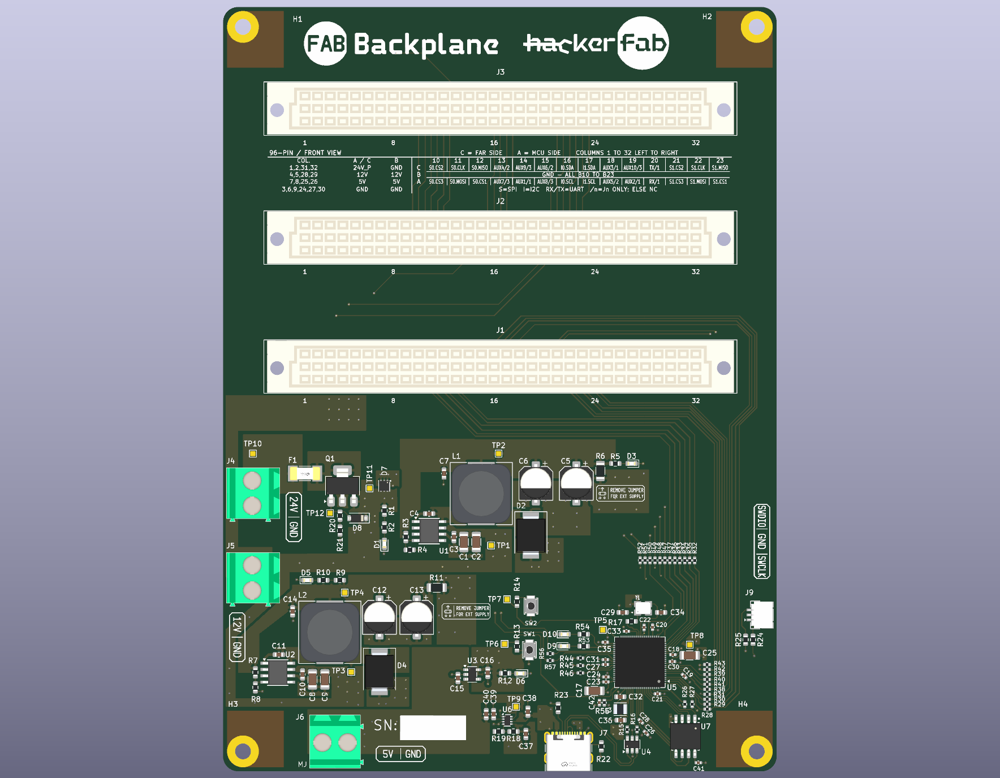
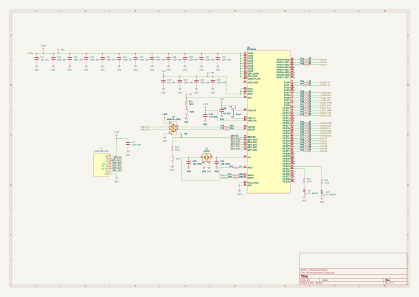
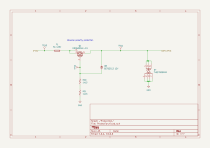

# FAB Computer · HackerFab

A modular control platform for HackerFab equipment: one backplane for power and control, with interchangeable daughter boards for each tool.

**Status: hardware in development · KiCad 10 · three expansion slots**



*Audited development PCB. See the [design audit](docs/design-audit-2026-11-04.md) for open electrical and manufacturing findings.*

## The idea

Keep the microcontroller, power supplies, and common interfaces on a reusable backplane. Put tool-specific electronics on daughter boards so future teams can extend a system without redesigning its core. Initial applications described in the project report are nanopositioning and sputtering equipment.

The current backplane sources contain an **RP2350B**, three **96-pin DIN 41612 connectors**, **12 V and 5 V buck regulators**, a **3.3 V LDO**, USB-C and power-selection circuitry, and an input-protection sheet. The intended input supply is **24 V DC**. Shared signals include two I²C buses, two SPI buses, two independent UARTs, and auxiliary GPIO.

## Open the design

1. Install **KiCad 10** with its standard symbol and footprint libraries. The supplied files were saved in KiCad 10 and checked with 10.0.6.
2. Clone the entire repository:

   ```sh
   git clone https://github.com/jonahsaunders/fab-computer-hackerfab.git
   ```

3. Open [`hardware/backplane/HackerfabBackplane.kicad_pro`](hardware/backplane/HackerfabBackplane.kicad_pro) in KiCad's project manager.
4. Open the schematic or PCB from the project manager. The custom libraries are registered in the project's library tables using relative paths; no global library setup is needed for them.

For a browser-only look, start with the [schematic previews](docs/schematics/README.md).

## What's here

| Location | Contents |
| --- | --- |
| [`hardware/backplane/`](hardware/backplane/) | KiCad project, root schematic, six subsheets, PCB, custom design rules, and project library tables |
| [`hardware/libraries/`](hardware/libraries/) | Seven custom symbol libraries and 24 custom footprints, including embedded models where supplied |
| [`docs/architecture.md`](docs/architecture.md) | System concept, circuit blocks, and scope of future daughter boards |
| [`docs/connector-pinout.md`](docs/connector-pinout.md) | Jumper-based signal order, paired protocols, pin table, and routing guide |
| [`docs/schematics/`](docs/schematics/) | Seven SVG schematic previews exported from the source |
| [`docs/design-audit-2026-11-04.md`](docs/design-audit-2026-11-04.md) | Electrical audit, resolved issues, remaining risks, and bring-up criteria |
| [`docs/validation.md`](docs/validation.md) | Import checks, ERC/DRC evidence, and reproduction steps |
| [`docs/thermal-relief.md`](docs/thermal-relief.md) | Copper-pour diagnosis, affected pads, and temporary-copy experiments |
| [`docs/provenance.md`](docs/provenance.md) | Source archives, background reference, and cleanup details |
| [`scripts/`](scripts/) | Repository checks and reproducible preview/check exports |

## Design images

These previews are exported from the current KiCad files. Select a schematic image to open it at full size.

### Backplane schematic

[](docs/schematics/HackerfabBackplane.svg)

### Microcontroller

[](docs/schematics/HackerfabBackplane-Microcontroller.svg)

### 12 V buck regulator

[](docs/schematics/HackerfabBackplane-12V%20Buck%20Regulator.svg)

### 5 V buck regulator

[](docs/schematics/HackerfabBackplane-5V%20Buck%20Regulator.svg)

### 3.3 V LDO

[](docs/schematics/HackerfabBackplane-3V3%20LDO.svg)

### USB voltage mux

[](docs/schematics/HackerfabBackplane-USB%20Voltage%20MUX.svg)

### Input protection

[](docs/schematics/HackerfabBackplane-Protection.svg)

## Current state

The repository includes the **backplane hardware and its libraries**. Firmware, daughter-board designs, fabrication outputs, and bench-test results were not present in the supplied archives.

The latest archives were imported and audited on **2026-11-04**. They add a second UART on J2 through R56/R57. J1 uses hardware UART0; J2 uses UART1 (named `UART2` in the schematic); J3's UART positions remain NC. All **288 connector pins** agree between the current reference, schematic, and PCB. The design has **148 components/footprints**, **1,114 track segments**, and **267 vias**.

The audit corrected stale copper fills, the UART silkscreen legend, and RP2350B flash metadata. Final checks report **15 ERC findings**, **362 DRC warnings with zero DRC errors**, **zero unconnected PCB items**, and **zero normal schematic/PCB parity findings**. The [validation notes](docs/validation.md) also disclose checks normally ignored by the project.

**The design is not fabrication-ready.** Open items include missing backplane I²C pull-ups, AUX10's missing MCU connection, the shared 5 V path's 2.5 A ceiling and USB fallback behavior, regulator stability/thermal validation, USB VBUS sensing, and fabrication-rule cleanup. The [full audit](docs/design-audit-2026-11-04.md) distinguishes confirmed gaps from issues requiring load information or measurements. Normal operation is assumed to use a current-limited bench supply at the 24 V input.

## Working on the project

The connector signal assignments use the V6 layout, with SPI buses at opposite ends and matching protocol groups across rows A/C. J1 is nearest the MCU and carries AUX1–3 plus UART; J2 carries AUX4–6 plus the second UART; J3 carries AUX7–9 with AUX10 reserved and not connected to the MCU. Use the [current pin table and diagrams](docs/connector-pinout.md) when routing or designing daughter boards. Power and ground assignments are preserved.

Read [CONTRIBUTING.md](CONTRIBUTING.md) before changing hardware. Run the lightweight repository checks with Python 3.10 or newer:

```sh
python scripts/check_repo.py
python scripts/test_connector_pinout.py
```

To regenerate the schematic previews, board image, and local ERC/DRC reports with KiCad 10:

```sh
python scripts/export_design.py
```

The checks verify repository structure and library portability; they do not certify the electrical design.

## Credits and license

Backplane and library sources supplied by **Jonah Saunders**. Project background is drawn from *Hackerfab Progress Report 1 - FAB Computer*, with sections by **Jonah Saunders** and **Jacob Rohozen**. The report was used as background and is not redistributed here.

A project license has not yet been specified. Existing attribution within supplied files is preserved.
