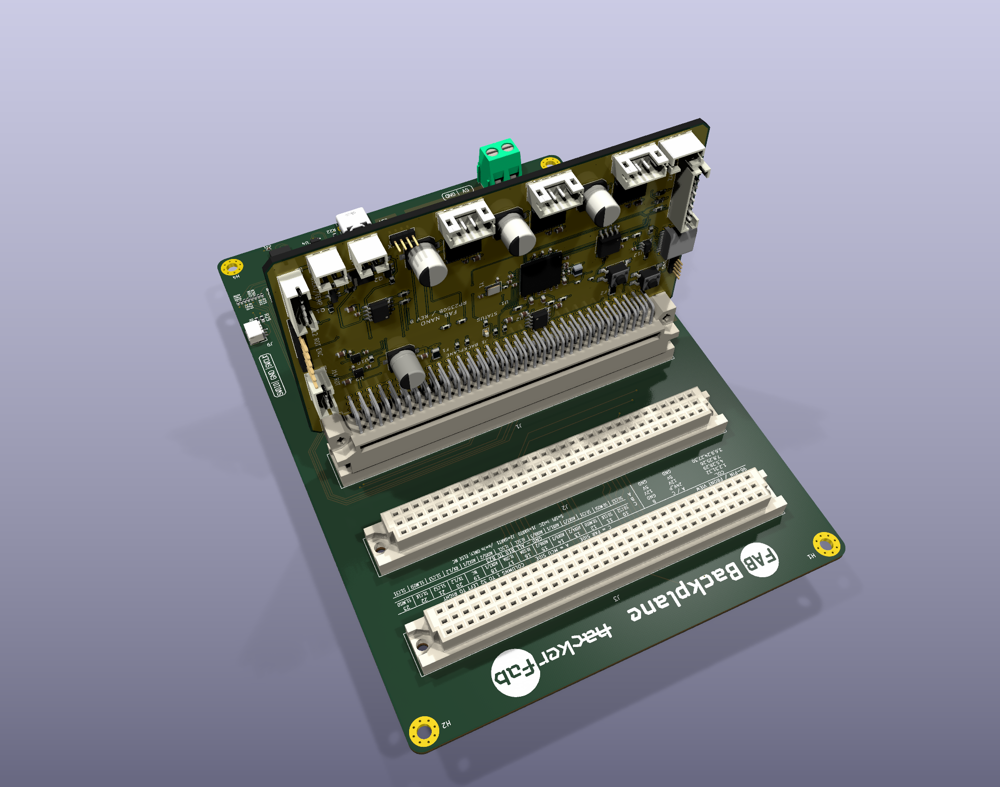
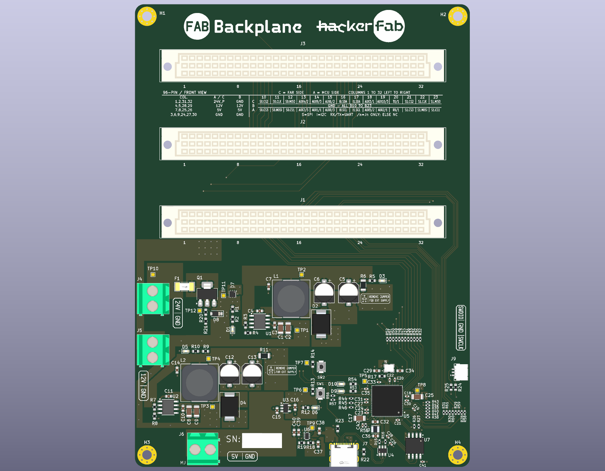
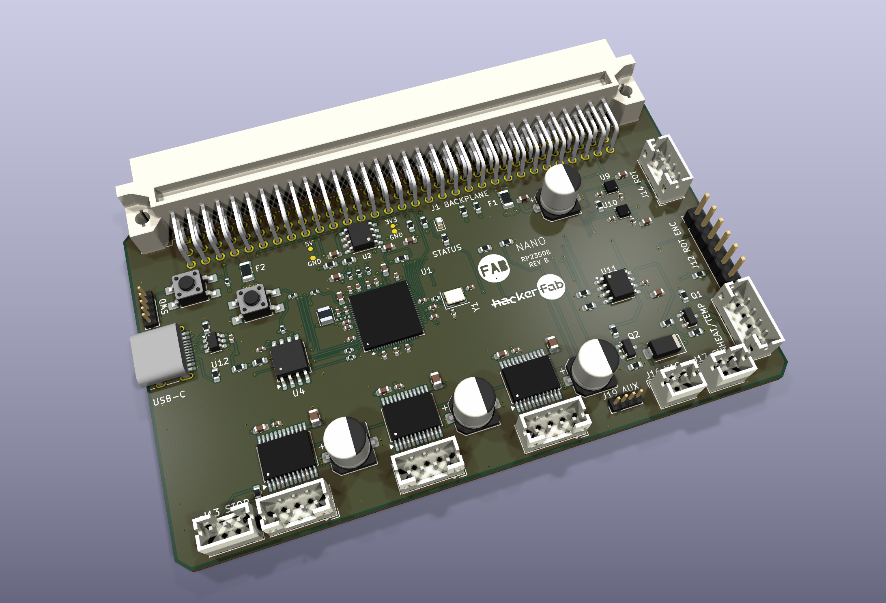

# FAB Computer · HackerFab

A reusable power and control backplane with plug-in boards for HackerFab tools.



*Nominal KiCad assembly in slot J1. [Reverse view](daughterboards/micromanipulator/docs/host-single-back.png) · [Adjacent-card clearance](daughterboards/micromanipulator/docs/host-adjacent-front.png). Mating plugs, cable bends and retention hardware are not modeled.*

## The boards

| Backplane | Micromanipulator daughterboard |
| --- | --- |
|  |  |
| Shared power, RP2350B master and three DIN96 slots. Intended 24 V input; regulated 12 V and 5 V distribution. | Bare RP2350B, XYZ motion, rotation, heater and vacuum. 100 × 60 mm, four layers, USB-C and the original encoder interfaces. |
| [KiCad project](hardware/backplane/HackerfabBackplane.kicad_pro) · [Schematics](docs/schematics/README.md) | [KiCad project](daughterboards/micromanipulator/hardware/daughterboard/FabNanoDaughterboard.kicad_pro) · [Schematic PDF](daughterboards/micromanipulator/docs/schematic-review.pdf) · [Board details](daughterboards/micromanipulator/README.md) |

The micromanipulator also includes the original [8-pin-to-three-6-pin encoder splitter](daughterboards/micromanipulator/hardware/encoder-splitter/), plus [rail probes and connector pin legends](daughterboards/micromanipulator/docs/probe-and-label-review.md).

## Open and review

Clone the entire repository and open either project above in **KiCad 10**. Keep its local libraries with it; standard KiCad symbol libraries are also required.

```sh
git clone https://github.com/jonahsaunders/fab-computer-hackerfab.git
```

Both boards remain development hardware. The daughterboard is manually routed with zero ERC, DRC, unconnected or schematic-parity findings; physical fit, load/thermal measurements and firmware migration remain open. The backplane is preserved as supplied, with its separate historical validation record. No fabrication release or firmware binaries are included.

Use host **J1 or J2** for the micromanipulator; J3 lacks UART. The host's **5 V supply is limited by a shared 2.5 A power mux**, so tool loads must fit the remaining system budget. See the [interface table](docs/connector-pinout.md) and [load limits](daughterboards/micromanipulator/docs/load-power-review.md).

## Design references

- [System architecture](docs/architecture.md) and [backplane validation](docs/validation.md)
- [Daughterboard validation](daughterboards/micromanipulator/docs/validation.md), [connector fit](daughterboards/micromanipulator/docs/connector-review.md) and [power-layer map](daughterboards/micromanipulator/docs/power-domains.svg)
- [Contributing and checks](CONTRIBUTING.md); run `python scripts/check_repo.py` before submitting changes
- [Source history](docs/provenance.md) and [upstream micromanipulator](https://github.com/hacker-fab/MicroManipulatorStepper)

Backplane sources: **Jonah Saunders**. Project background: **Jonah Saunders and Jacob Rohozen**. No overall project license has been specified; existing notices and [upstream daughterboard licenses](daughterboards/micromanipulator/licenses/) are retained.
