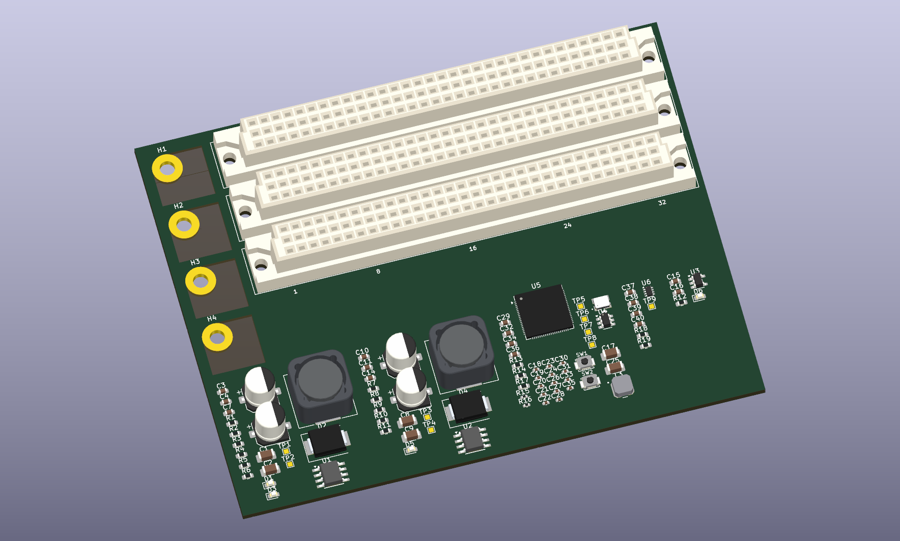

# FAB Computer · HackerFab

A modular control platform for HackerFab equipment: one backplane for power and control, with interchangeable daughter boards for each tool.

**Status: hardware in development · KiCad 10 · three expansion slots**



*Placement preview of the imported PCB. Routing and the board outline are unfinished; this is not a manufacturing release.*

## The idea

Keep the microcontroller, power supplies, and common interfaces on a reusable backplane. Put tool-specific electronics on daughter boards so future teams can extend a system without redesigning its core. Initial applications described in the project report are nanopositioning and sputtering equipment.

The current backplane sources contain an **RP2354B**, three **96-pin DIN 41612 connectors**, **12 V and 5 V buck regulators**, a **3.3 V LDO**, USB-C and power-selection circuitry, and an input-protection sheet. The intended input supply is **24 V DC**. Shared signals include two I²C buses, two SPI buses, UART, and auxiliary GPIO.

## Open the design

1. Install **KiCad 10** with its standard symbol and footprint libraries. The supplied files were saved in KiCad 10 and checked with 10.0.6.
2. Clone the entire repository:

   ```sh
   git clone https://github.com/jonahsaunders/fab-computer-hackerfab.git
   ```

3. Open [`hardware/backplane/HackerfabBackplane.kicad_pro`](hardware/backplane/HackerfabBackplane.kicad_pro) in KiCad's project manager.
4. Open the schematic or PCB from the project manager. The custom libraries are registered in the project's library tables using relative paths; no global library setup is needed for them.

For a browser-only look, start with the [schematic previews](docs/schematics/README.md).

## What's here

| Location | Contents |
| --- | --- |
| [`hardware/backplane/`](hardware/backplane/) | KiCad project, root schematic, six subsheets, PCB, and project library tables |
| [`hardware/libraries/`](hardware/libraries/) | Seven custom symbol libraries and 22 custom footprints, including embedded models where supplied |
| [`docs/architecture.md`](docs/architecture.md) | System concept, circuit blocks, and scope of future daughter boards |
| [`docs/schematics/`](docs/schematics/) | Seven SVG schematic previews exported from the source |
| [`docs/validation.md`](docs/validation.md) | Import checks, existing ERC/DRC findings, and next steps |
| [`docs/provenance.md`](docs/provenance.md) | Source archives, background reference, and cleanup details |
| [`scripts/`](scripts/) | Repository checks and reproducible preview/check exports |

## Current state

The repository includes the **backplane hardware and its libraries**. Firmware, daughter-board designs, fabrication outputs, and bench-test results were not present in the supplied archives.

The sources were updated from the supplied archives on **2026-10-26**. The schematic hierarchy and netlist export successfully, with **109 schematic components**. The supplied PCB remains at **93 footprints** and has no routed track segments. KiCad reports **74 ERC findings**, **151 DRC findings**, **413 unconnected PCB items**, and **59 schematic/PCB parity findings**. The PCB needs to be synchronized with the updated schematic. See the [validation notes](docs/validation.md) for the breakdown and commands.

## Working on the project

Read [CONTRIBUTING.md](CONTRIBUTING.md) before changing hardware. Run the lightweight repository checks with Python 3.10 or newer:

```sh
python scripts/check_repo.py
```

To regenerate the schematic previews, board image, and local ERC/DRC reports with KiCad 10:

```sh
python scripts/export_design.py
```

The checks verify repository structure and library portability; they do not certify the electrical design.

## Credits and license

Backplane and library sources supplied by **Jonah Saunders**. Project background is drawn from *Hackerfab Progress Report 1 - FAB Computer*, with sections by **Jonah Saunders** and **Jacob Rohozen**. The report was used as background and is not redistributed here.

A project license has not yet been specified. Existing attribution within supplied files is preserved.
