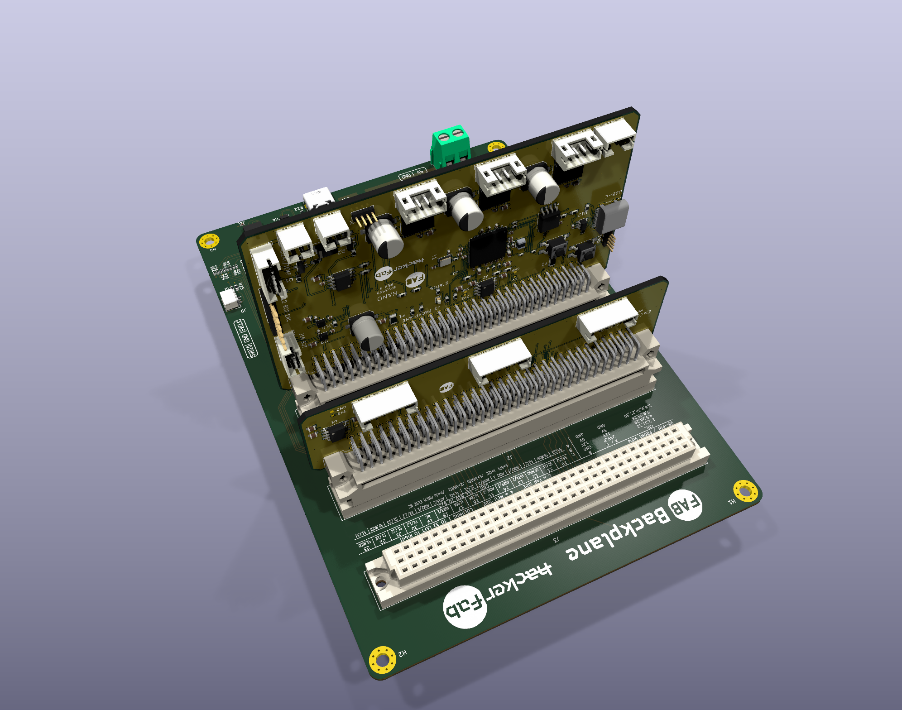

# Micromanipulator cards

Bare-component adaptation of [MicroManipulatorStepper](https://github.com/hacker-fab/MicroManipulatorStepper) for the FAB Computer backplane. One RP2350B controls XYZ motion, rotation, heater and vacuum. A second, shallow card distributes encoder SPI to the three existing sensor boards. No development boards are used.

| Board | Size | Open in KiCad 10 | Review |
| --- | --- | --- | --- |
| Motion controller | 100 × 60 mm, 4 layers | [Project](hardware/daughterboard/FabNanoDaughterboard.kicad_pro) | [Schematic](docs/schematic-review.pdf), [3D](docs/board-3d.png), [BOM](docs/bom.csv) |
| Encoder splitter | 100 × 26 mm, 4 layers | [Project](hardware/encoder-backplane/EncoderBackplane.kicad_pro) | [Schematic](docs/encoder-backplane-schematic.pdf), [3D](docs/encoder-backplane.png), [BOM](docs/encoder-backplane-bom.csv) |

Keep this folder together: footprints and models resolve locally or through embedded data, with original library names preserved. Standard KiCad symbol libraries are needed for editing. Both boards use **signal / power / ground / signal**, SMD capacitors, edge-accessible connectors, and 0.8 mm bare 5 V/3.3 V probes with nearby grounds. The motion board has 117 fitted components plus four probe pads; the splitter has 11 plus four. Some models are explicitly nominal; see the [model inventory](docs/model-inventory.csv).

## Installation and bus ownership

Place motion in host **J1 or J2**; J3 lacks UART. The encoder card can use any remaining slot. SPI travels through the existing backplane contacts. **Motion owns SPI0; the host must leave GPIO16–21 as inputs with no pulls.** All three SPI0 selects are reserved for these encoders. Other cards must leave this bus undriven. The backplane design is unchanged; no 3.3 V contact was added. Local regulators derive 3.3 V from the existing 5 V rail.

The three PH6 sensor ports preserve their original pin order. The old PH8 cable connection is replaced by the DIN bus; motion GPIO44/45/46 now select the sensors. Rotation encoder J12 remains unchanged. See the [bus/contact map](docs/backplane-encoder-bus.md), [connector table](docs/connectors.csv) and [firmware integration notes](firmware/README.md). The [original 36 × 36 mm splitter](hardware/encoder-splitter/) is retained only as a source reference.

## Review status

Both active boards pass native ERC, DRC, connectivity and schematic parity; all nine schematic pages pass the geometric text/wire audit. The 35 checked direct decoupling paths and all 48 local capacitor ground returns on the motion card remain intact. USB routing now uses six data vias with a local ground reference beneath its connector/ESD launch; see the [USB review](docs/usb-routing-review.md). See [validation](docs/validation.md), [routing](docs/layout-front.svg), [power plane](docs/power-plane.svg), [decoupling](docs/decoupling-review.md), and [reverse assembly view](docs/host-adjacent-back.png).

These are development designs. The assembly uses nominal mating-model placement; physical seating, plugs and cable access need verification. Begin encoder SPI at 1 MHz and validate the actual harness before using the original 8 MHz rate. Firmware consolidation is outstanding; configuration headers are included, not binaries.

The host 5 V mux has a **shared 2.5 A limit**. Heater, pump, sensors, host and logic must fit within that total with margin. The source heater estimates 1.4 A; rotation/pump currents remain unspecified in the checked upstream repository. See [load limits](docs/load-power-review.md), [logic supply](docs/power-budget.md), [connector fit](docs/connector-review.md) and [sources/licenses](licenses/). No fabrication release is claimed.
