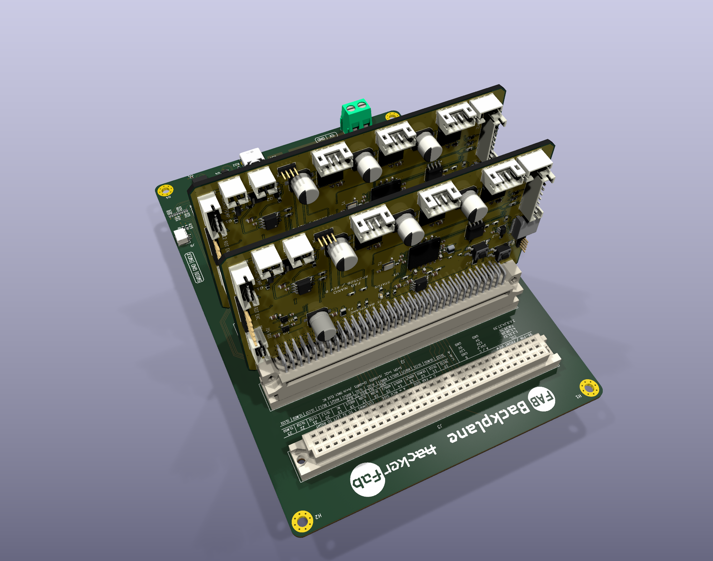
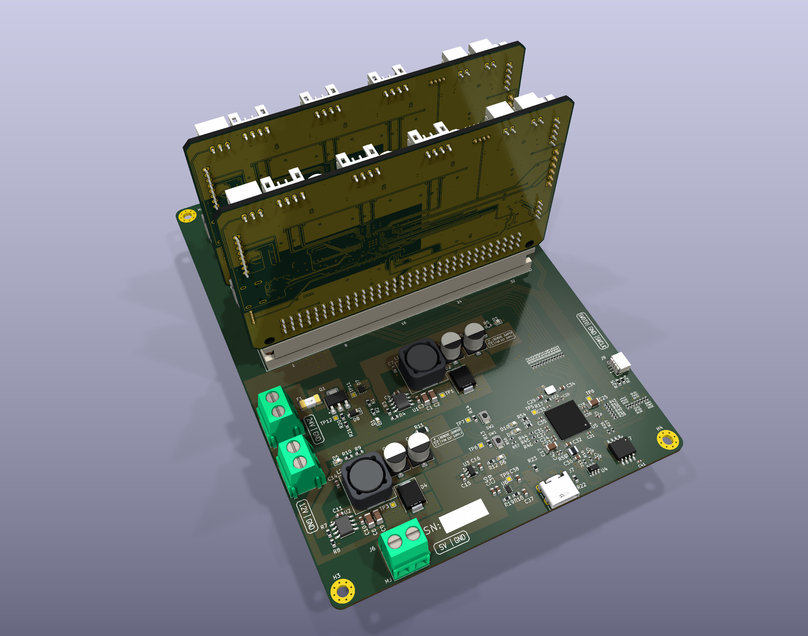

# Connector selection and host-interface review

All fourteen external connectors now have exact ordering parts in the schematic and PCB. This revision selects the thirteen DIN/JST/pin headers; J18 retains its previously selected USB-C part. It changes procurement fields only: all pads, nets, routing, placement, models and visible schematic content are unchanged, verified by parsed-file comparison.

| References | Manufacturer part | JLCPCB assembly catalog |
| --- | --- | --- |
| J1 | WingTAT 9001-11961C00A | [C5173361](https://jlcpcb.com/partdetail/WingTAT-900111961C00A/C5173361) |
| J2 | XUNPU PH1.27-01-05PZD | [C41360740](https://jlcpcb.com/partdetail/XUNPU-PH1_27_0105PZD/C41360740) |
| J3, J4, J5, J14 | JST B4B-PH-K-S(LF)(SN) | [C131334](https://jlcpcb.com/partdetail/B4B-PH-K-S%28LF%29%28SN%29/C131334) |
| J6 | JST B8B-PH-K-S(LF)(SN) | [C157974](https://jlcpcb.com/partdetail/JST-B8B_PH_K_S_LF_SN/C157974) |
| J12 | BOOMELE 2.54-1x6PStraight pin | [C37208](https://jlcpcb.com/partdetail/38187-2_54_1x6PStraightpin/C37208) |
| J13 | JST B3B-PH-K-S(LF)(SN) | [C131339](https://jlcpcb.com/partdetail/B3B-PH-K-S%28LF%29%28SN%29/C131339) |
| J15 | JST B5B-PH-K-S(LF)(SN) | [C157993](https://jlcpcb.com/partdetail/JST-B5B_PH_K_S_LF_SN/C157993) |
| J16, J17 | JST B2B-PH-K-S(LF)(SN) | [C131337](https://jlcpcb.com/partdetail/JST-B2B_PH_K_S_LF_SN/C131337) |
| J18 | HRO TYPE-C-31-M-12 | [C165948](https://jlcpcb.com/partdetail/HRO_TYPE-C-31-M-12/C165948) |
| J19 | XUNPU PH1.27-01-04PZD | [C41360739](https://jlcpcb.com/partdetail/XUNPU-PH1_27_0104PZD/C41360739) |

Catalog identity and assembly listings were checked on 2026-11-07. Inventory is order-dependent. The encoder harness connectors and pin assignments are retained.

## DIN connector

The host uses WingTAT 9001-12961C00A female sockets. The selected male plug has the corresponding Type C mating arrangement. Its [manufacturer drawing 9001D11001 R7](https://www.lcsc.com/datasheet/C5173361.pdf) specifies 2.54 mm row/column pitch, 78.74 mm pin span, 1.00 mm signal holes and 88.90 mm mounting-hole spacing. These match the saved card. Its 2.85 mm mounting drills lie within the drawing's 2.8 ± 0.1 mm range. The card retains 1.55 mm signal lands.

The board edge is 5.08 mm ahead of row A, 0.22 mm recessed from the drawing's 5.30 mm recommendation. This leaves more of the connector overhanging the PCB. The card now uses the WingTAT-specific STEP already embedded in the supplied backplane library. All 96 solder-tail centers match the saved footprint to within 0.000001 mm. Extraction preserves the original STEP geometry; it does not certify manufacturing tolerances. The [female drawing 9001D12003 R7](https://www.lcsc.com/datasheet/C5173363.pdf) defines the host mating geometry.

## Host electrical allocation

`scripts/check_backplane_interface.py` reads the actual host and daughterboard PCBs. It checks all 288 host contacts against the card's 96-contact allocation and verifies the four signal paths through their resistors to the MCU pins.

Run it from the repository checkout with KiCad's Python. For a standalone daughterboard copy, supply `--host PATH` pointing to the host PCB. Reports go to `build/`.

- J1 and J2 provide both UART and I²C. Host TX reaches daughter GPIO29/RX; daughter GPIO28/TX reaches host RX. I²C reaches GPIO30/SDA and GPIO31/SCL.
- Host J3 has no UART at A20/C20; it cannot provide the full current interface.
- The card uses 12 contacts each for 12 V and 5 V, 36 grounds and four signals. Its other 32 contacts, including every 24 V position, remain unused.
- Actual host slot pitch is 26 mm. This measurement alone does not verify populated-card or cable clearance.

## Populated host review

The actual host J1/J2 positions and its embedded WingTAT socket models were combined with two exports of the populated daughterboard for a nominal assembly review. Both cards stand perpendicular to the host, with the component faces oriented alike. The reviewed views show no apparent component-body interference between these two cards. USB opens beyond the side edge; the PH connectors face the space between cards, near their perimeter, so their leads can turn toward the card edges.

The card model uses a 90-degree KiCad X rotation and nominal placement offset of (0, -2.01, 17.74) mm relative to each host row-A pin-1 origin. This aligns the plug contacts and seats the modeled nose near the socket flange plane. The transform is an engineering inference from the supplied models, not a specified seated-board dimension. Actual seating stop, retention, cable housings, cable bend radii, enclosure and other daughterboard designs still need a physical fit check. Two cards in these images demonstrate geometry only; their combined electrical load is not approved by the rendering.

## JST PH footprints

The nine PH headers have the [JST-recommended](https://www.jst-mfg.com/product/pdf/eng/ePH.pdf) 2.00 mm pitch and 0.75 mm drills within its 0.70–0.80 mm guideline. The nominal 1.6 mm board is within the specified board-thickness range. These top-entry connectors mate above the component face; matching housings are PHR-2/3/4/5/8 with contacts chosen for the actual wire gauge. JST's 2 A rating assumes AWG24 and is not a blanket rating for every harness or load. Final heater/pump load and cable specifications remain open.

## Unshrouded headers

J2 and J19 use XUNPU's [PH1.27-01-NPZD family](https://www.lcsc.com/datasheet/C41360740.pdf). Its recommended 1.27 mm pitch and 0.65 mm holes match the existing footprints. The 0.40 mm square pins extend 3.9 mm above the 1.0 mm insulator; the solder tails are 2.3 mm long. J12 uses BOOMELE's [2.54-1xNA-H2.5-L11.2 family](https://www.lcsc.com/datasheet/C37208.pdf), with the existing 2.54 mm pitch and 1.0 mm holes. Its 0.64 mm square pins extend 5.7 mm above the 2.5 mm insulator, with 3.0 mm solder tails. The manufacturer's drawing resolves the catalog description's inconsistent 6.0 mm mating-pin value.

The header pitch/drill checks are included in `check_backplane_interface.py`. These pins mate above the component face, and all signal assignments remain unchanged. Their bundled KiCad models remain nominal library representations; use the dimensions above for exact cable and socket engagement. The two 1.27 mm headers are rated 1 A; J12 is rated 3 A, subject to the mating contact and wire limits. All three parts have JLCPCB wave-solder assembly listings. J18 retains its reviewed STEP model.
