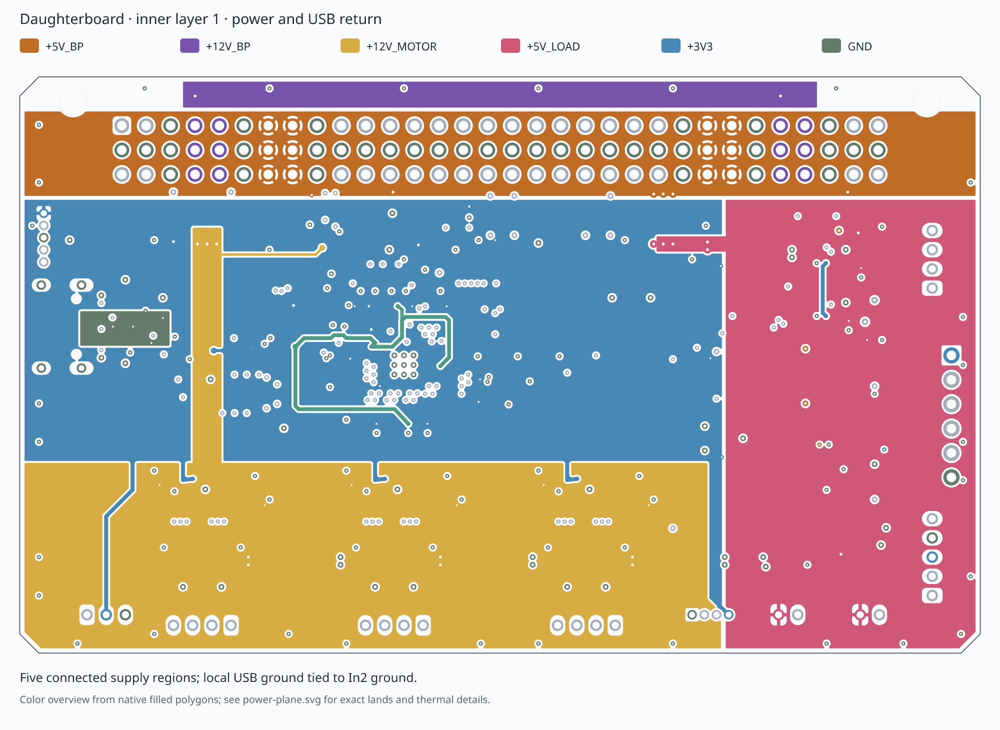
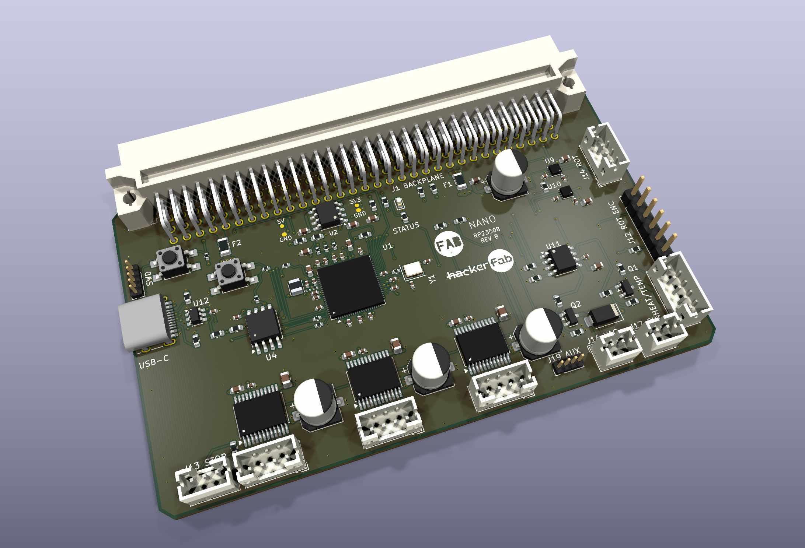

# Routed-board review

The board is 100 × 60 mm, with one RP2350B and all external connectors on the perimeter. The DIN96 connector and every harness pinout/placement match the earlier checked board. The local 3.3 V regulator now uses the SO-8 package; both schematic and PCB reflect its different pin numbering. U1 procurement requires RP2350B A4 silicon.

## Bypass paths and ground

All 35 checked local supply paths connect on F.Cu, without a via-plane-via detour. The [path table](decoupling-paths.csv) records actual saved-board trace lengths. All 48 capacitors have dedicated ground-via returns, with solid pad-to-pour settings; the [return table](capacitor-returns.csv) measures their traces. The [capacitor review](decoupling-review.md) documents placement changes, paired bulk-capacitor vias, crystal routing and explicit tradeoffs. The core regulator has direct input/output capacitor returns to PGND. The adjacent front pour is cut back around its switching loop.

In2.Cu contains one connected ground region and no signal tracks. F.Cu ground fills connect the capacitor returns, MCU and driver grounds. B.Cu ground fills support the power stages and board perimeter. Fifty-seven additional, individually placed 0.45/0.20 mm stitching vias connect these areas. Disconnected copper islands are removed on every zone. Power-driver ground pads connect solidly to their local pour. These choices improve return geometry; they are not a loop-inductance or EMI measurement.

## Stackup and USB

### Power distribution cleanup

The right-hand fused 5 V region previously contained long transverse 3.3 V feeds and a winding unfused 5 V gate-driver feed. Those feeds now use explicit F.Cu/B.Cu routes. Their combined In1 length within the right-hand region (x >= 123.5 mm) falls from 90.053 mm to 6.212 mm; the remaining short inner trace joins the two rotation-driver logic bypass feeds. The 3.3 V zone now ends at its main distribution boundary instead of filling small pockets around remote vias.

All five inner supply zones each retain one connected filled region, and In2 ground remains one connected region with the same outline. This restores broad fused 5 V copper without changing a component, pad, interface, supply domain or high-current output route. The gate buffer remains powered upstream of F1. All 35 direct supply-to-pin paths and 48 capacitor ground returns are preserved. The copper topology is improved; this is not a measured thermal or EMI result.

### Layer construction

The physical stackup records the nominal **JLC04161H-7628** construction: F.Cu 35 µm / 7628 prepreg 0.2104 mm / In1.Cu 15.2 µm / core 1.065 mm / In2.Cu 15.2 µm / 7628 prepreg 0.2104 mm / B.Cu 35 µm. Layer functions are signal / power / ground / signal. Overall board thickness is nominally 1.6 mm; published individual layer figures and mask thicknesses are nominal process values, not a mechanical tolerance stack. Confirm the stackup with the fabricator. [JLCPCB stackups](https://jlcpcb.com/impedance).

The principal USB connector-to-series-resistor pair runs on B.Cu with 0.26 mm width and 0.15 mm gap, referenced to In2.Cu. Coplanar B.Cu pour is excluded from the USB/MCU corridor. Connector, ESD and resistor launches use short narrower sections. The 27 Ω resistors now sit beside the MCU, with 2.652 mm and 0.987 mm direct front-layer stubs and no vias after them. These short stubs are not continuously coupled. See the [USB routing review](usb-routing-review.md) for part selection, the equivalent ESD-channel swap and measurements. The recorded stackup gives an approximate 89.96 Ω differential impedance for the uniform main pair. All 2,337 checked back-layer sample points have In2 ground underneath, excluding the immediate signal-via antipads. This is an engineering screen, not a measured impedance/compliance result; solder mask, launches and packages are outside that calculation. Fabricator confirmation and prototype measurements remain required. The 27 Ω resistors and direct USB supply bypassing follow the [RP2350 hardware guide](https://pip-assets.raspberrypi.com/categories/1214-rp2350/documents/RP-008280-DS-1-hardware-design-with-rp2350.pdf?disposition=inline).

## Assembly and access

All 32 daughterboard footprint types are copied into project-local libraries without changing library names. All 117 fitted components have local or embedded models; the four bare probe pads have no body models. KiCad standard STEP models are used where available. RP2350B, DRV8837C and TB6612FNG have clearly identified nominal VRML models. The three axis drivers use a project-local Toshiba footprint with corrected body/courtyard geometry; their original pads and copper are preserved. USB-C uses the detailed Nabu Casa Yellow / ai03 STEP model, aligned to the existing HRO footprint with its opening facing off the left card edge. These models do not substitute for manufacturer tolerance drawings.

The USB connector opens off the left card edge. JST PH and pin-header harnesses mate above the component face; the DIN plug faces the insertion edge. The native 3D view shows these directions and no apparent body collisions. Two populated cards were rendered in the actual host J1/J2 slots with no apparent body interference. Cable bend space and exact seating/retention still require the actual harness and hardware.

The [connector review](connector-review.md) specifies WingTAT 9001-11961C00A for J1 and exact JST parts for all nine PH headers. Their hole patterns match manufacturer drawings. The saved host PCB has 26 mm slot pitch; J1/J2 carry the required UART and I²C interface, while J3 lacks UART. The card uses the WingTAT-specific STEP extracted from the host library; all 96 tail centers match the saved footprint. No connector placement or pinout changes accompany these selections.

The added pin/probe legends use 0.8 mm text and 0.12 mm strokes; the existing larger labels remain. The back face carries pad-aligned connector legends and a DIN contact table. Front silkscreen reuses the host's FAB/HackerFab vector artwork. The eleven thermal vias inside soldered exposed pads are explicitly marked **filled and copper-capped**; ordinary stitching vias are tented. Confirm that process and the QFN/WSON stencil apertures with the assembler. [JLCPCB capabilities](https://jlcpcb.com/capabilities/Capabilities).

Only 5 V and 3.3 V have added rail probes, each with an adjacent ground pad. All four are 0.8 mm front-surface copper spots without drills or paste apertures. See the [probe and splitter review](probe-and-label-review.md). The daughterboard outline is unchanged. SPI routing and the slow supply-sense filter were subsequently revised for the slot-mounted splitter; see the [bus review](backplane-encoder-bus.md).

## Outstanding engineering checks

Exact supplier selections and package reviews are recorded for all 117 components. The source specifies 12 V / 0.4 A axis motors. Its heater copper estimates 1.40 A at 5.25 V; rotation and pump currents are not specified in the checked repository. The [load power review](load-power-review.md) records the 4 A branch fuses, stronger common feeds and conditional maximum 2 A combined tool allocation within the host's shared 2.5 A mux limit. The USB and nominal host-fit engineering reviews are complete to their stated scope; fabricated impedance, physical seating/cables and actual load/thermal performance still need validation. The [logic supply review](power-budget.md) records a provisional 250 mA allocation and the SO-8 regulator's thermal estimate; final current and temperature require measurement. The present fuses and copper are design choices, not tested current ratings. Firmware consolidation and electrical/thermal bench validation are also outstanding. No manufacturing or commissioning release is claimed.

