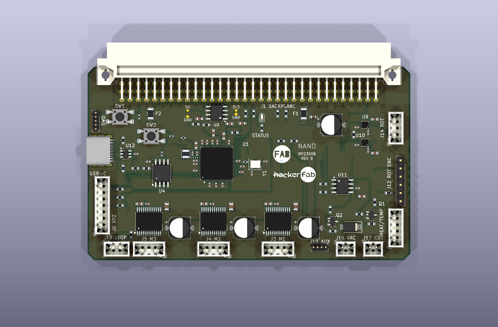
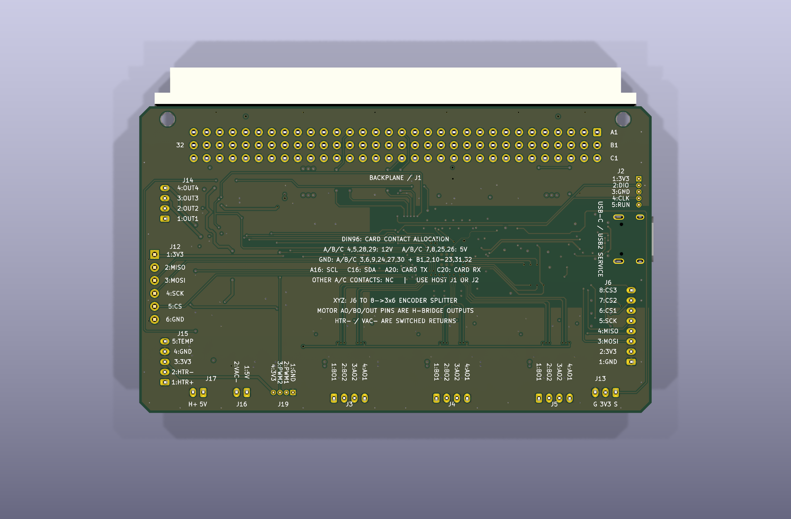

# Rail probes, connector legends and encoder splitter

The daughterboard remains **100 × 60 mm** with the same four-layer stack, DIN96 interface and connector placements. No existing component, pad, signal track or power feed was moved. The additions are four exposed copper pads, short sensing branches, three nearby connection vias and silkscreen artwork. The vias are separate from the probe surfaces.

| Reference | Signal | Purpose |
| --- | --- | --- |
| TP1 | +5V_BP | Backplane 5 V, before the tool-load fuse F1 |
| TP2 | +3V3 | Local regulator output |
| TP3 | GND | Ground beside TP1, 1.90 mm center-to-center |
| TP4 | GND | Ground beside TP2, 1.15 mm center-to-center |

Each probe is a **0.8 mm round surface pad** on front copper with a solder-mask opening: no drilled hole, no solder-paste aperture and no fitted component. This is smaller than the host's 1.0 × 1.0 mm pads. Pads are labeled `5V`, `3V3` and `GND`; references are available in KiCad and the Power schematic. They are excluded from the BOM and placement files and need no 3D body model. No other rail or signal testpoints were added.

The probe symbols branch directly from the corresponding supply/ground wiring on the Power sheet. The connector-only top sheet is unchanged. The four branches introduce no four-way junctions or text/wire collisions.

## Silkscreen

The front uses the actual FAB and HackerFab vector artwork from the host, scaled into the existing open area. Connector pin legends are on the **back face**, aligned with the solder pads so housings do not hide them. The new text is 0.8 mm or larger with 0.12 mm strokes, preserving the project's existing DRC limits. The DIN table describes this card's actual contact allocation, including unused contacts and UART direction from the card's perspective.

Motor legends use the actual driver output names, not fixed supply polarities. XYZ pins are `BO1, BO2, AO2, AO1`; rotation pins are `OUT1–OUT4`. For the compact endstop legend, `S` means signal and `G` means ground. At J17, `H+` is the heater supply after the thermal cutoff. All other signal legends use their connector pin number.

| Front: probes and logo | Back: connector pin legends |
| --- | --- |
|  |  |

## Included original SPI splitter

The upstream [EncoderBoard](https://github.com/hacker-fab/MicroManipulatorStepper/tree/fa9a1f8e6d5365c6d5d5f31054d4f2c95aff8f6a/electronics) is the missing **passive 8-pin-to-three-6-pin SPI breakout**, not an encoder sensor module. It is now included at [hardware/encoder-splitter](../hardware/encoder-splitter/). The original 36 × 36 mm outline, connectors, holes, copper and pin assignments are preserved. It remains a separate cable-connected board; it adds no area to the daughterboard.

Connect daughterboard **J6 to splitter J4 pin-for-pin**. J1, J2 and J3 on the splitter each serve one XYZ encoder. They share 3.3 V, ground, clock, MOSI and MISO, with a separate chip-select for each axis. Rotation encoder J12 remains separate and has a different pin order.

[Splitter 3D view](encoder-splitter.png) · [Splitter schematic PDF](encoder-splitter-schematic.pdf)

| Signal | Daughter J6 / splitter J4 | Splitter J1 | Splitter J2 | Splitter J3 |
| --- | --- | --- | --- | --- |
| GND | 1 | 1 | 1 | 1 |
| 3.3 V | 2 | 6 | 6 | 6 |
| MOSI | 3 | 4 | 4 | 4 |
| MISO | 4 | 5 | 5 | 5 |
| SCK | 5 | 3 | 3 | 3 |
| CS1 | 6 | 2 | — | — |
| CS2 | 7 | — | 2 | — |
| CS3 | 8 | — | — | 2 |

The splitter import bundles its connector models and exact footprint geometry locally, updates the input caption to daughterboard J6, normalizes empty datasheet fields and adds explicit no-connect markers for its isolated mounting pads plus power flags for the externally supplied rails. These are library/annotation changes, not a circuit or routing redesign. The original `spi_distro.diy` is included as an additional upstream reference. The retained [MIT license](../licenses/MicroManipulatorStepper-MIT.txt) credits the original work.

Both projects pass native ERC, DRC, connectivity and schematic/PCB parity checks. `scripts/check_probe_access.py` verifies pad geometry and all splitter pin assignments. Existing host-interface, USB, supply-domain and decoupling checks also pass. The new pads and artwork do not replace the existing load, thermal, firmware and physical-fit review requirements.
