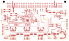

# Design validation — 2026-11-07

This is a development snapshot, not a manufacturing release. The seven-sheet schematic and 100 × 60 mm PCB both use one RP2350B. The root schematic contains only the 14 external connectors, a ground symbol and six hierarchical blocks. The fixed DIN96 interface and encoder harness pin maps are retained.

| KiCad 10.0.6 check | Result |
| --- | --- |
| Schematic ERC, including four-way junctions | **0 violations** |
| Seven-page SVG audit | **0** text/wire collisions, text/text collisions, interior wire crossings or overlapping wire segments |
| Hierarchy audit | **14** root connectors, **0** root support components, all **7** sheets reachable |
| PCB DRC violations, apart from connectivity | **0** |
| PCB unconnected items | **0** |
| Schematic/PCB parity | **0 issues** |
| Components / copper layers | **116 / 4** |

The layer order is front signal / inner power / inner ground / back signal. The board contains 572 explicit manual route entries and 1494 track segments/vias, including 54 added ground-stitching vias. Eight filled zones include the inner power regions, a single connected In2 ground region and grounded outer copper. No autorouter was used. Courtyard, via-endpoint, footprint-filter and pad-type checks are enabled. A native-board comparison confirms all 14 connectors retain their placement, orientation, pad geometry and electrical connections. The two USB CC nets have descriptive names after the hierarchy change described below.

USB support components U12, C66 and R48–R51 now reside in USBInterface. A comparison of native KiCad netlists before and after the move proves that all 145 electrical pin groups are identical. Only `Net-(J18-CC1)` and `Net-(J18-CC2)` were renamed to `/USB_CC1` and `/USB_CC2`. A full parsed-board comparison, allowing only those names and the six updated schematic paths, proves that all PCB geometry, zones, models and other metadata are unchanged. The root and USB child were also inspected as rendered pages.

All 35 checked local supply/bypass connections have a continuous front-copper path to the served pin. All 48 capacitor ground pads also have explicit front-copper paths to ground vias; their pad-to-pour settings use solid copper. The revised measurements include both supply traces and dedicated ground returns. See the [decoupling review](decoupling-review.md) and [measured lengths](decoupling-paths.csv). The ground-return and stackup decisions are recorded in the [layout review](layout-review.md).

All 30 footprint types resolve from project-local libraries. All 116 component instances have models: 115 project-relative files and one embedded upstream STEP model. Three component instances use newly made nominal models (RP2350B and two DRV8837C devices); these are identified in the [inventory](model-inventory.csv). USB-C now uses a detailed community STEP model. Its twelve distinct contact positions and four shell-tab locations were checked against the footprint, and a saved-board comparison confirms unchanged pads, nets, positions and routes. The native 3D rendering was inspected for component placement and connector access. Exact procurement/package review, USB signal-integrity confirmation, host mating tolerances, load/thermal limits and firmware consolidation remain open. These checks do not establish electrical performance or manufacturing readiness.

## Reproduce

Run from this folder, with KiCad 10 available. Create `build/` first.

```sh
kicad-cli sch erc --format json --severity-all --exit-code-violations --output build/erc-current.json hardware/daughterboard/FabNanoDaughterboard.kicad_sch
kicad-cli pcb drc --format json --severity-all --schematic-parity --output build/drc-current.json hardware/daughterboard/FabNanoDaughterboard.kicad_pcb
kicad-cli sch export svg --output docs/schematics/ hardware/daughterboard/FabNanoDaughterboard.kicad_sch
python scripts/check_schematic_visuals.py
python scripts/check_hierarchy.py
python scripts/check_decoupling.py
python scripts/check_capacitor_returns.py
```

Inspect the DRC report: its default exit status does not fail for findings. The repository's root checker validates the host backplane; it does not replace these daughterboard checks.

[](layout-front.svg)
