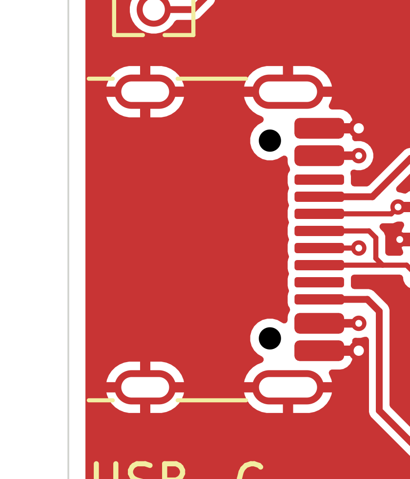

# Design validation

The baseline review below is from 2026-11-08; the motion-card USB-C correction was checked again on 2026-11-16. Two active projects: the 100 × 60 mm motion card and the new 100 × 26 mm encoder card. Both use four layers (signal / power / ground / signal), project-local footprints and models, and manually routed copper. These are development designs, not a manufacturing release.

| KiCad 10.0.6 check | Motion | Encoder |
| --- | --- | --- |
| ERC | 0 | 0 |
| DRC errors/warnings/exclusions | 0 | 0 |
| Unconnected items | 0 | 0 |
| Schematic/PCB parity | 0 | 0 |
| Text/wire, text/text, crossings, overlaps, zero-length wires | 0 on 7 pages | 0 on 2 pages |
| Fitted parts + bare probe pads | 117 + 4 | 11 + 4 |

Four-way-junction checking is enabled. The only ignored PCB check is the existing tuning-profile track-geometry check; these boards contain no length-tuning profiles. No new electrical or silkscreen exclusions were added. The motion root contains 13 external connectors and six hierarchical sheets; the encoder root contains its four connectors and one power/pull-up sheet. All support parts remain in subsheets.

## USB-C mounting-slot correction — 2026-11-16

J18's two shell slots nearest the connector opening now match the **0.60 × 1.40 mm** holes in the [HRO TYPE-C-31-M-12 drawing](https://datasheet.lcsc.com/datasheet/pdf/9e56b777c022540fcce7c7f67825f55e.pdf?productCode=C165948). Their copper lands grew from 1.00 × 1.60 mm to **1.00 × 1.80 mm**, retaining a 0.20 mm nominal annular ring. The project-local footprint and its placed PCB instance both have this correction at local coordinates `(±4.32, 1.05)` mm. The rear 0.60 × 1.70 mm slots are unchanged.

All nine copper zones were refilled. Comparison with the preceding PCB confirms that only those two pad sizes/drills and the resulting filled copper changed: component positions, tracks, pad nets, and the board outline are preserved. Library and placed-pad dimensions match. Updated front/back and inner-plane previews accompany the change; the close-up below includes filled front copper.

[](usb-mounting-slots.png)

KiCad **10.0.6** reports **0 ERC findings, 0 DRC errors/warnings/exclusions, 0 unconnected items, and 0 schematic/PCB parity findings**. DRC was clean before and after the edit. Existing ignored checks are unchanged. The repository check and all ten motion-card audit scripts listed below pass, including power-domain continuity, USB launch/reference coverage, decoupling, and connector interfaces.

The regenerated Excellon file has two 0.60 mm cutter slots with 0.80 mm center travel, giving the required 1.40 mm overall length. The copper Gerbers contain the enlarged lands. Native filling/capping exports select the same eleven 0.30 mm vias as the existing via-fill map. The schematic BOM still has 117 fitted parts; the CPL retains the existing catalog-specific centers and rotations. See the [manufacturing files](../../../docs/manufacturing/README.md#motion-controller) for export provenance. Physical fit and prototype electrical/thermal validation remain open as described below.

## Electrical and mechanical audits

- All 288 host contacts compared against motion DIN96; UART is available in host J1/J2, absent in J3. Eight PH and three pin-header footprints checked. The host board is unchanged.
- The six SPI0 contacts match across both cards and all three host slots. The five 33 Ω source resistors and new GPIO44/45/46 chip selects match the schematic, board and configuration header. Host R32–R37 connect these signals to GPIO16–21: firmware must keep them inputs with no pulls.
- All three encoder PH6 pin orders match the retained upstream splitter. The old PH8 cable and motion J6 are removed. The established backplane contact assignments are retained.
- All 35 measured direct capacitor-to-served-pin supply paths remain on front copper; all 48 capacitor grounds retain explicit local via returns and solid pour settings. The USB source stubs remain 2.652/0.987 mm without vias.
- The slot-card revision preserves the motion outline, the position/orientation of all retained components except slow supply-sense filter C4, and every retained track's net assignment. MCU decouplers are unmoved. C24's plane-feed via changes sides; its direct pin connection is retained.
- Every inner power region and the motion In2 ground plane remains one connected filled region. The gate buffer remains on unfused backplane 5 V while tool loads remain fused.
- Each active card has only two 0.8 mm SMD rail probes and two nearby ground pads, no drill or paste. Ground centers are within 2 mm. Probe pads are excluded from BOM and placement files.
- All 128 fitted component instances across the two active boards have local or embedded model references. The DIN model path was shortened to avoid a Windows path-length rendering failure; its geometry and transforms are unchanged.

The native assembled views now contain motion in host J1 and the actual encoder card in J2. Both mating DIN models are visible and the component bodies show no apparent collision. Sensor headers are on the shallow card's exposed edge, and USB-C opens sideways from the motion card. These are nominal model placements: seating tolerance, cable housings, insertion access and cable bend radii require physical checks.

The subsequent USB launch cleanup moves only U12 and C66, reduces ten physical data vias to five, with two layer changes on every connector-to-MCU path, and adds a local In1 ground reference beneath the connector/ESD traces. All pad nets, schematics, MCU decouplers, connector placement, outline and project rules remain unchanged. A total of 3,261 sampled trace-center/edge points have adjacent ground outside the declared signal-via antipad exclusions. Each inner copper region remains connected. DRC, unconnected and parity counts remain zero; see the [USB measurements](usb-routing-review.md).

## Remaining validation

Reserve SPI0 for one motion/encoder pair; host GPIO16–21 must stay inactive throughout boot and operation. Firmware consolidation is unfinished; the included headers are integration aids, not tested firmware. Begin SPI at 1 MHz and measure the actual backplane/cable signals before returning to the upstream 8 MHz rate. Sensor MISO and unused-slot stubs particularly need checking.

Physical mating, fabricated USB impedance, actual current, transients and thermal performance remain unverified. All 5 V consumers share the backplane's 2.5 A mux limit. The original rotation/pump load ratings are absent from the checked source. See [bus requirements](backplane-encoder-bus.md), [load limits](load-power-review.md), [decoupling](decoupling-review.md), [USB review](usb-routing-review.md), and [connector review](connector-review.md).

## Reproduce

Run using KiCad 10's Python and CLI. Reports belong in ignored `build/`.

```sh
kicad-cli sch erc --format json --severity-all --exit-code-violations --output build/erc-current.json hardware/daughterboard/FabNanoDaughterboard.kicad_sch
kicad-cli pcb drc --format json --severity-all --schematic-parity --exit-code-violations --output build/drc-current.json hardware/daughterboard/FabNanoDaughterboard.kicad_pcb
kicad-cli sch erc --format json --severity-all --exit-code-violations --output build/encoder-erc.json hardware/encoder-backplane/EncoderBackplane.kicad_sch
kicad-cli pcb drc --format json --severity-all --schematic-parity --exit-code-violations --output build/encoder-drc.json hardware/encoder-backplane/EncoderBackplane.kicad_pcb
python scripts/check_schematic_visuals.py
python scripts/check_schematic_visuals.py --encoder
python scripts/check_hierarchy.py
python scripts/check_backplane_interface.py
python scripts/check_encoder_bus.py
python scripts/check_probe_access.py
python scripts/check_decoupling.py
python scripts/check_capacitor_returns.py
python scripts/check_power_domains.py
python scripts/check_usb_termination.py
python scripts/check_usb_launch.py
```

Re-export SVGs from current schematics before auditing edited pages. The root repository checker checks host libraries and links; it does not replace these daughtercard checks. The original 36 × 36 mm splitter is retained only as a historical reference.
