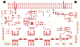

# Design validation — 2026-11-07

This is a development snapshot, not a manufacturing release. The six-sheet schematic and 100 × 60 mm PCB both use one RP2350B. All 14 external connectors are on the root schematic. The fixed DIN96 interface and encoder harness pin maps are retained.

| KiCad 10.0.6 check | Result |
| --- | --- |
| Schematic ERC, including four-way junctions | **0 violations** |
| Six-page SVG audit | **0** text/wire collisions, text/text collisions, interior wire crossings or overlapping wire segments |
| PCB DRC violations, apart from connectivity | **0** |
| PCB unconnected items | **28 — routing unfinished** |
| Schematic/PCB parity | **0 issues** |
| Components / copper layers | **116 / 4** |

The layer order is front signal / inner power / inner ground / back signal. The current board contains 480 explicit routed connections, represented by 1082 track segments and vias, plus filled power and ground zones. No autorouter was used. Courtyard, via-endpoint, footprint-filter and pad-type checks are enabled.

All 35 checked local supply/bypass connections have a continuous front-copper path to the served pin. Six MCU bypass loops previously depended on inner-layer connections; those paths are now direct. See the [decoupling review](decoupling-review.md) and [measured lengths](decoupling-paths.csv). This supply-path check is separate from the final ground-return review.

The PCB still needs its remaining signal routes, final return-path and power review, complete footprint and model verification, supplier selection, and final mechanical checks. Firmware consolidation and electrical/thermal bench validation remain open. The bundled body-envelope models are review aids inherited from the earlier layout; they have not all been updated for this revision.

## Reproduce

Run from this folder, with KiCad 10 available. Create `build/` first.

```sh
kicad-cli sch erc --format json --severity-all --exit-code-violations --output build/erc-current.json hardware/daughterboard/FabNanoDaughterboard.kicad_sch
kicad-cli pcb drc --format json --severity-all --schematic-parity --output build/drc-current.json hardware/daughterboard/FabNanoDaughterboard.kicad_pcb
kicad-cli sch export svg --output docs/schematics/ hardware/daughterboard/FabNanoDaughterboard.kicad_sch
python scripts/check_schematic_visuals.py
```

Inspect the DRC report: its default exit status does not fail for findings. The repository's root checker validates the host backplane; it does not replace these daughterboard checks.

[](layout-incomplete.svg)
