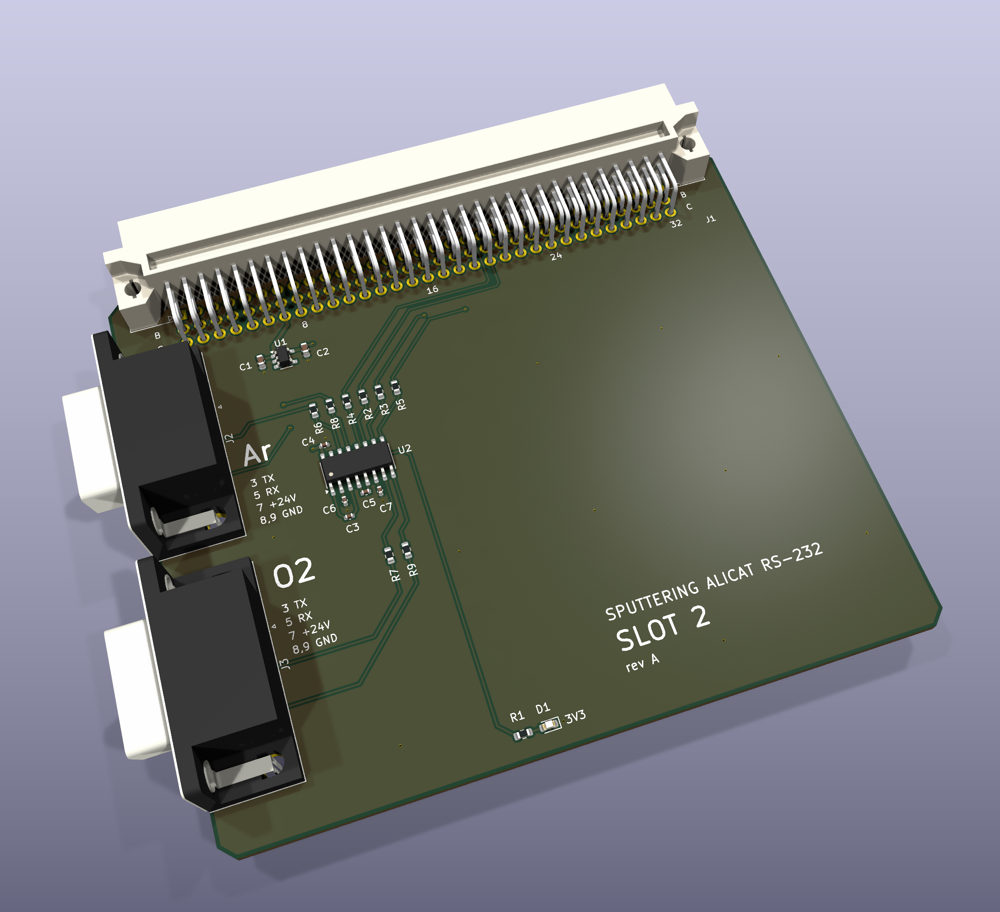

# Sputtering cards

Two cards for the sputtering backplane. No MCU on either; the backplane's RP2350B drives them.

[Repository overview](../../README.md#sputtering-cards) · [Review and validation](docs/validation.md) · [Manufacturing guide](../../docs/manufacturing/README.md#sputtering-cards)

| Board | Slot | Size | Open in KiCad 10 | Review |
| --- | --- | --- | --- | --- |
| Pump + gauge + USB | J1 | 100 × 65 mm, 2 layers | [Project](hardware/pump-gauge-usb/sputtering-pump-gauge-usb.kicad_pro) | [Schematic](docs/sputtering-pump-gauge-usb-schematic.pdf), [3D](docs/sputtering-pump-gauge-usb-3d.png), [BOM](../../docs/manufacturing/sputtering-pump-gauge-usb/BOM.csv) |
| Alicat | J2 | 100 × 85 mm, 2 layers | [Project](hardware/alicat/sputtering-alicat.kicad_pro) | [Schematic](docs/sputtering-alicat-schematic.pdf), [3D](docs/sputtering-alicat-3d.png), [BOM](../../docs/manufacturing/sputtering-alicat/BOM.csv) |

Keep this folder together: libraries resolve from [`hardware/libraries/`](hardware/libraries/).

The projects also use the standard symbol and footprint libraries installed with KiCad 10. Design sources, local libraries, schematic PDFs, renders and review notes live in this section. Fabrication exports follow the repository's shared manufacturing layout:

| Board | Fabrication | Assembly |
| --- | --- | --- |
| Pump + gauge + USB | [Gerbers and drills](../../docs/manufacturing/sputtering-pump-gauge-usb/Gerbers.zip) | [BOM](../../docs/manufacturing/sputtering-pump-gauge-usb/BOM.csv) · [CPL](../../docs/manufacturing/sputtering-pump-gauge-usb/CPL.csv) |
| Alicat | [Gerbers and drills](../../docs/manufacturing/sputtering-alicat/Gerbers.zip) | [BOM](../../docs/manufacturing/sputtering-alicat/BOM.csv) · [CPL](../../docs/manufacturing/sputtering-alicat/CPL.csv) |

## Backplane connections

Slot names below refer to the host: use **J1 for pump + gauge + USB** and **J2 for Alicat**. Both cards name their own DIN96 plug J1. These slot assignments use the host's slot-specific UART and AUX connections; the cards are not interchangeable between slots.

| Card | Backplane use |
| --- | --- |
| Pump + gauge + USB | UART0 pump (RS-485), GPIO40 direction; I²C0 gauge ADC (0x48); GPIO22/23 PIO-USB host |
| Alicat | UART1 argon, GPIO24/25 PIO UART oxygen (RS-232) |

## Review status

The [PR #16 connector update](https://github.com/jonahsaunders/fab-computer-hackerfab/pull/16), submitted by [jacobro100](https://github.com/jacobro100), adds pump-card screw terminals and male Alicat DB9 connectors. KiCad 10.0.6 reported no ERC errors or warnings and no DRC errors, unconnected items or schematic-parity findings. DRC reported **9 warnings on pump + gauge + USB** and **24 warnings on Alicat**. See the [review record](docs/validation.md) for categories, reproduction commands and remaining manufacturing and bench checks.
