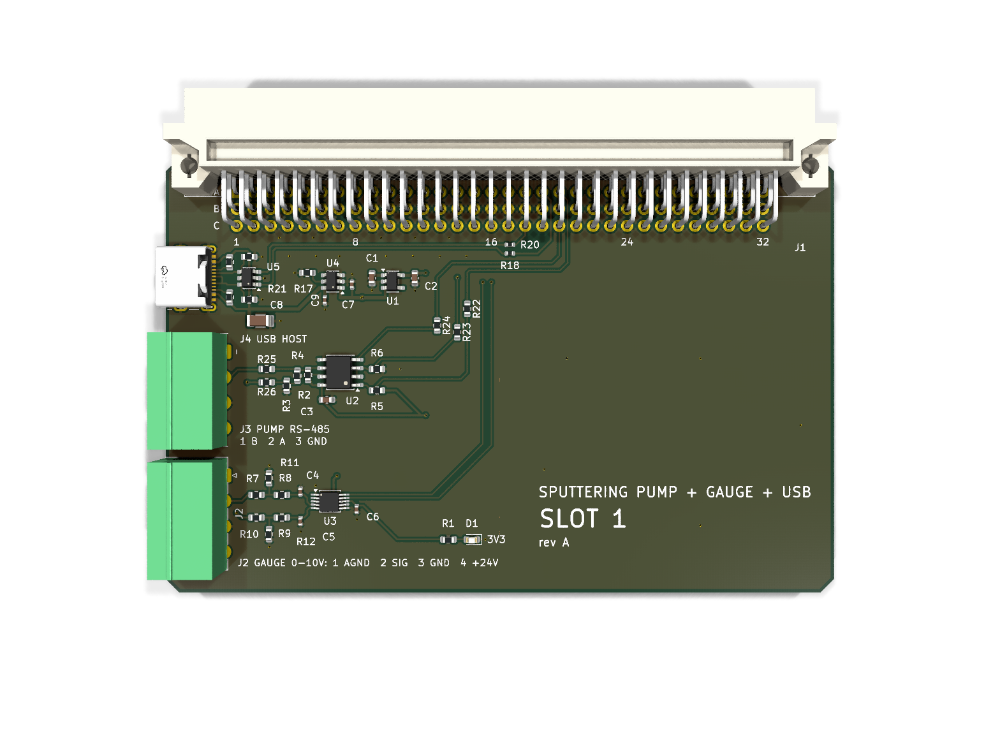

# Sputtering cards

Two cards for the sputtering backplane. No MCU on either; the backplane's RP2350B drives them.

| Board | Slot | Size | Open in KiCad 10 | Review |
| --- | --- | --- | --- | --- |
| Pump + gauge + USB | J1 | 100 × 65 mm, 2 layers | [Project](hardware/pump-gauge-usb/sputtering-pump-gauge-usb.kicad_pro) | [Schematic](docs/sputtering-pump-gauge-usb-schematic.pdf), [3D](docs/sputtering-pump-gauge-usb-3d.png), [BOM](../../docs/manufacturing/sputtering-pump-gauge-usb/BOM.csv) |
| Alicat | J2 | 100 × 85 mm, 2 layers | [Project](hardware/alicat/sputtering-alicat.kicad_pro) | [Schematic](docs/sputtering-alicat-schematic.pdf), [3D](docs/sputtering-alicat-3d.png), [BOM](../../docs/manufacturing/sputtering-alicat/BOM.csv) |

Keep this folder together: libraries resolve from [`hardware/libraries/`](hardware/libraries/).

| Card | Backplane use |
| --- | --- |
| Pump + gauge + USB | UART0 pump (RS-485), GPIO40 direction; I²C0 gauge ADC (0x48); GPIO22/23 PIO-USB host |
| Alicat | UART1 argon, GPIO24/25 PIO UART oxygen (RS-232) |

No ERC, DRC or schematic-parity errors on either card.
