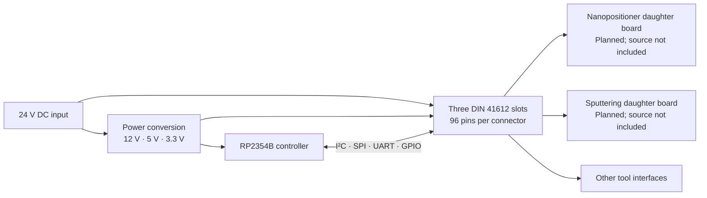

# System architecture

## Purpose

FAB Computer separates the reusable controller and power circuitry from the interfaces specific to each piece of HackerFab equipment. A new tool adds a daughter board; the backplane provides common infrastructure.

This is the design intent described in the progress report. The repository currently contains the backplane design and shared component libraries, with implementation and validation still in progress.

The diagram is a functional overview, not a wiring diagram. Use the KiCad schematics for exact connections and the [validation notes](validation.md) for incomplete circuitry.

## Backplane blocks

| Block | Present in the supplied design |
| --- | --- |
| Controller | RP2354B (`U5`) with supporting crystal, decoupling, and debug signals |
| Expansion | Three DIN 41612 connectors (`J1`–`J3`, `9001-12961C00A`) |
| 12 V and 5 V rails | Two TPS5450DDAR regulators (`U1`, `U2`) |
| 3.3 V rail | AP2112K-3.3TRG1 (`U3`) |
| USB-related circuitry | USBLC6-2SC6 protection (`U4`) and TPS2116DRL power selection (`U6`); external connectivity still requires review |
| Communication | Named nets for I²C0/1, SPI0/1 with slot chip selects, UART, and AUX signals |

The report specifies UART on the first slot only. The current exported netlist instead connects `/UART_RX` to both `J1:C22` and `J3:C22`, while `/UART_TX` connects to `J1:A22`. This discrepancy needs design review. Do not assume every signal is available on every slot or that the preliminary connector pinout is frozen. Review the current schematic and connector numbering before designing a mating board.

## Daughter-board scope

The report describes two initial applications:

- **Nanopositioning:** move the existing development-board-based design toward an integrated daughter board, with motor-drive electronics specific to the tool.
- **Sputtering:** provide equipment interfaces such as RS-485 for a pump, RS-232 for a mass-flow controller, and conditioned analog measurement for a pressure gauge.

RS-485, RS-232, and 0–10 V analog interfaces are system requirements intended for daughter-board circuitry. They are not implemented interfaces on the current backplane. Firmware and daughter-board sources were not supplied.

## Next design milestones

- Complete schematic connectivity and resolve ERC findings.
- Review the connector pinout, component symbols, and footprints.
- Finish the PCB outline, placement, routing, and design review.
- Prepare manufacturing outputs from a reviewed revision.
- Add daughter-board and firmware sources, then record bench validation.

The report's original checkpoint schedule is historical project context, not evidence that these steps are complete.
