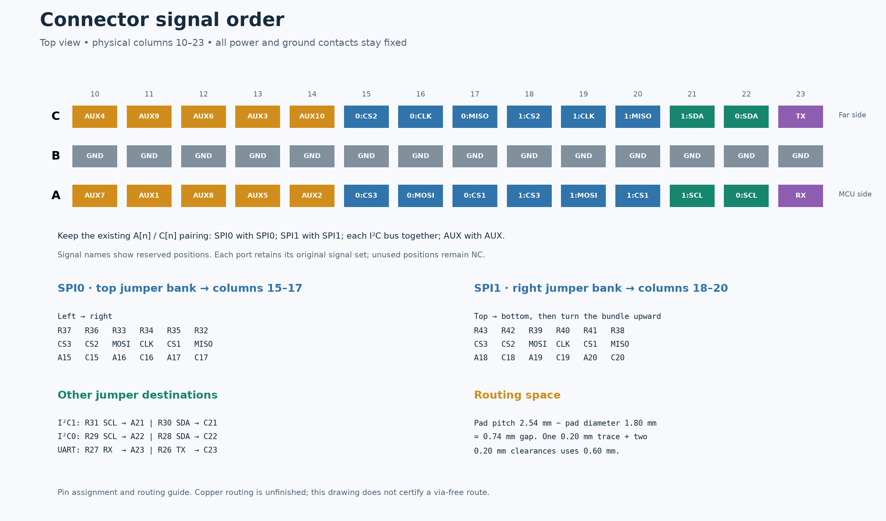
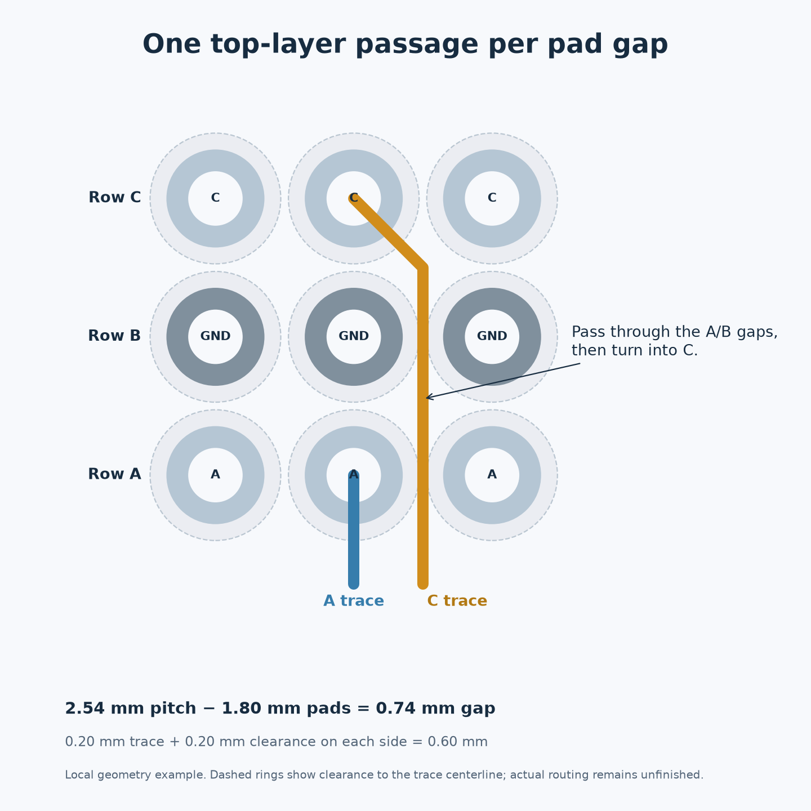

# Connector signal arrangement

The 2026-10-29 update reorders signal contacts around the existing 0 Ω jumper banks to reduce lane swaps during top-layer routing. It preserves the supplied design's **paired A/C column convention**: SPI0 faces SPI0, SPI1 faces SPI1, each I²C bus stays together, and AUX faces AUX. **UART RX and TX stay adjacent in one column.** Power, ground, MCU pin assignments, jumper placement, and existing copper are unchanged.

## Physical arrangement

Viewed from the PCB front, columns increase from left to right. Row **A** faces the MCU; row **C** is the far row. The pairing is **A[n] with C[n]**, matching the original layout's protocol grouping. Row B remains ground throughout columns 10–23. Power and ground outside this signal region retain their original pin assignments.

| Columns | A/C group | Routing purpose |
| --- | --- | --- |
| 10–14 | AUX | Follow the left and top AUX jumper banks |
| 15–17 | SPI0 | Follow the top bank from left to right |
| 18–20 | SPI1 | Follow the right bank from top to bottom as it turns upward |
| 21 | I²C1 | SCL and SDA together |
| 22 | I²C0 | SCL and SDA together |
| 23 | UART | RX and TX together, 5.08 mm apart across the B-row ground contact |

## Exact signal positions

These are the reserved functions across all three ports. The [CSV pin table](connector-pinout.csv) lists each port's actual connected or NC status and source jumper. The signal set available on each port is unchanged.

| Column | A — MCU side | C — far side |
| --- | --- | --- |
| 10 | AUX7 | AUX4 |
| 11 | AUX1 | AUX9 |
| 12 | AUX8 | AUX6 |
| 13 | AUX5 | AUX3 |
| 14 | AUX2 | AUX10 |
| 15 | SPI0_CS3 | SPI0_CS2 |
| 16 | SPI0_MOSI | SPI0_CLK |
| 17 | SPI0_CS1 | SPI0_MISO |
| 18 | SPI1_CS3 | SPI1_CS2 |
| 19 | SPI1_MOSI | SPI1_CLK |
| 20 | SPI1_CS1 | SPI1_MISO |
| 21 | I2C1_SCL | I2C1_SDA |
| 22 | I2C0_SCL | I2C0_SDA |
| 23 | UART_RX | UART_TX |

Both SPI buses, all six chip-select signals, and both I²C buses remain available on all three connectors. Slot-specific connections remain:

| Port | AUX connections | UART connections |
| --- | --- | --- |
| J1 | AUX1: A11; AUX2: A14; AUX3: C13 | RX: A23; TX: C23 |
| J2 | AUX4: C10; AUX5: A13; AUX6: C12 | Both NC |
| J3 | AUX7: A10; AUX8: A12; AUX9: C11; AUX10: C14 | RX: A23; TX: NC |

`AUX10` remains a connector-only signal without an MCU jumper; its existing isolated-label warning remains. UART_RX remains shared between J1 and J3, as in the supplied source.

## Follow the jumper exit order

For each column, approach A directly from below and take the following C trace through the gap on the right of that column. This gives the lane order **A15, C15, A16, C16, A17, C17** for SPI0, rather than sorting signals by their protocol names.

| Bundle | Existing jumper order | Matching connector order |
| --- | --- | --- |
| SPI0, left to right | R37, R36, R33, R34, R35, R32 | A15, C15, A16, C16, A17, C17 |
| SPI1, top to bottom | R43, R42, R39, R40, R41, R38 | A18, C18, A19, C19, A20, C20 |
| I²C1 | R31 SCL, R30 SDA | A21, C21 |
| I²C0 | R29 SCL, R28 SDA | A22, C22 |
| UART | R27 RX, R26 TX | A23, C23 |

Both SPI bundles retain their physical `CS3, CS2, MOSI, CLK, CS1, MISO` jumper sequence. As the right-side bundle turns upward, use nested bends that preserve this sequence. The AUX assignment follows the left-bank escape order `AUX7, AUX4, AUX1`, then the top-bank order `AUX9, AUX8, AUX6, AUX5, AUX3, AUX2`; AUX10 has no MCU route.

## Passing the connector on F.Cu

The 2.54 mm pitch and 1.80 mm pad diameter leave **0.74 mm** between pads. A **0.20 mm** trace with **0.20 mm** clearance to each adjacent pad requires **0.60 mm**, leaving 0.14 mm of geometric margin. A C-row trace can pass beside the A and B pads before turning into its C pad. No layer change is required by that local pad geometry. Two such traces need 1.00 mm, so use only one through each narrow gap.

This is a pin-assignment and routing-preparation update. No copper tracks or vias were added. Keeping the bundle order avoids deliberately exchanging lanes within each SPI fan-out, but the complete route still needs to be checked around existing copper, components, and ground pads. Shared signals continuing between the three connectors need additional passage lanes; the illustrated gap does not establish clearance for the entire backplane. Do not treat this arrangement as a completed via-free route.

## Validation

All 84 signal/NC assignments were updated in both schematic and PCB. All 288 connector pads were checked, with power/ground assignments and every nonconnector pin-to-net connection preserved. The board still has 518 track segments, 131 vias, and 107 unconnected items. KiCad reports the same 16 ERC and 97 DRC findings, with zero schematic/PCB parity findings.

`python scripts/check_repo.py` checks power/ground, A/C protocol pairing, adjacent UART contacts, the original signal inventory, and source-jumper nets against the CSV. `python scripts/export_design.py` regenerates the previews and KiCad reports. See [validation](validation.md) for the remaining design findings.
