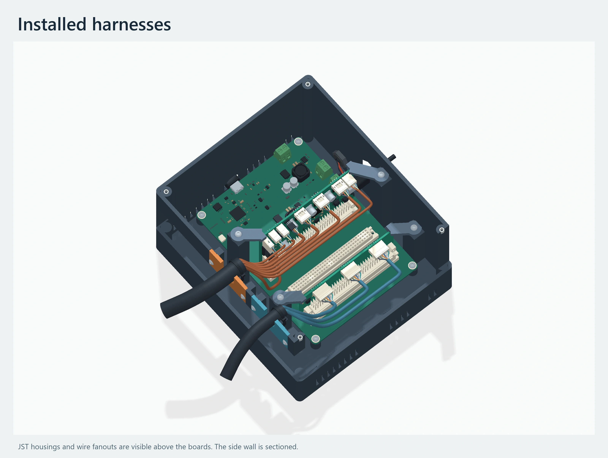
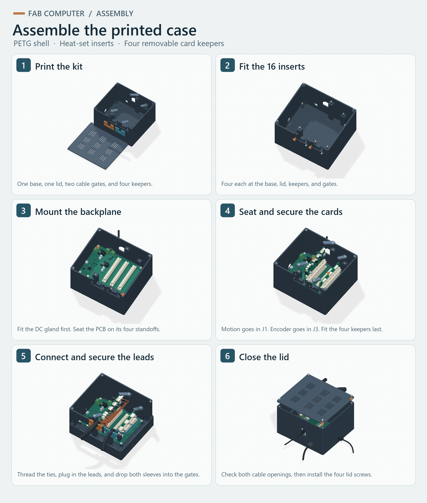
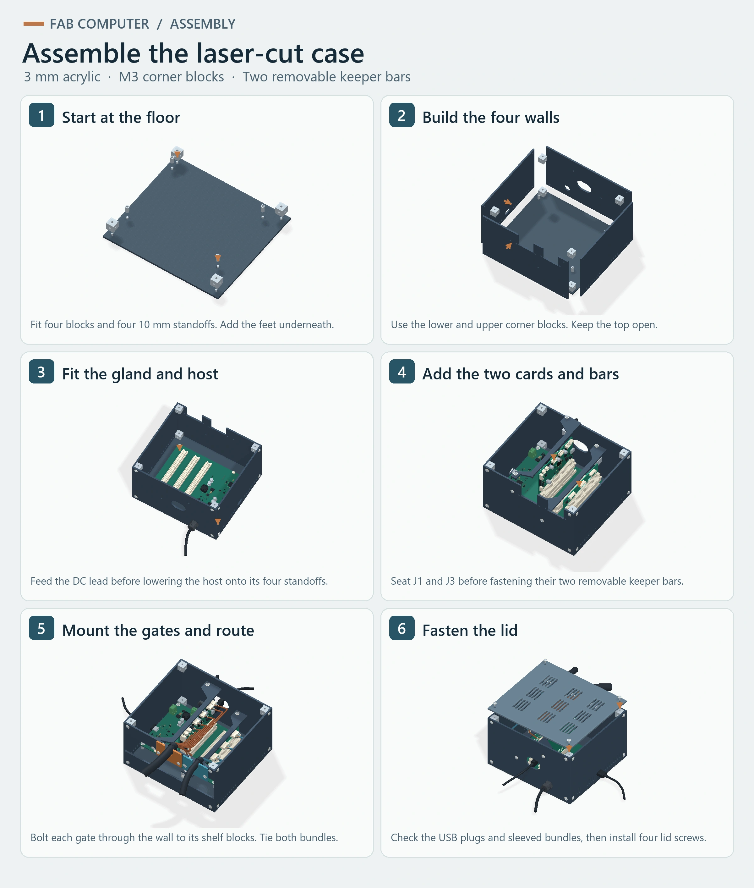

# FAB Computer enclosure

Rev 02 is a **166 × 186 × 112 mm** top-loading PETG case for the FAB Computer backplane, motion controller in **J1**, and encoder splitter in **J3**. The wired layout leaves J2 open. A removable vented lid, keyed card keepers, and screw-on cable gates provide access to the cards and harnesses.

[Download the CAD and print files](../../hardware/enclosure/FAB-Computer-Enclosure-CAD.zip) · [Mechanical BOM](../../hardware/enclosure/mechanical-bom.csv) · [Wired render](images/wired-case.webp) · [Parametric case source](../../hardware/enclosure/build_enclosure.py)

[Printed case assembly guide](#assembly-and-fit-check) · [Laser-cut version and assembly guide](#laser-cut-version)



## CAD and print parts

| Archive file | Contents |
| --- | --- |
| `FAB-Computer-Wired.step` | Colored assembly of the enclosure, all three populated KiCad boards, the case hardware, and routed cables with mating plug envelopes. The tree groups the boards, hardware, and harnesses for inspection. |
| `FAB-Computer-Enclosure.step` | The eight printed solids in their assembly positions. |
| `STL/` | Eight millimetre-scale meshes already oriented for printing. |

Print one of each part in PETG. The base and lid fit a 220 × 220 mm bed with a 5 mm brim. Rev 02 raises the integral tie supports to sit directly below the sleeved bundles at the side gates. Use the Rev 02 base for the wiring shown here.

| Part | STL in the archive |
| --- | --- |
| Base and integrated backplane standoffs | `01-base.stl` |
| Vented lid | `02-lid.stl` |
| Tool bundle gate | `03-tools-gate.stl` |
| Encoder bundle gate | `04-encoder-gate.stl` |
| Left and right motion card keepers | `05-motion-keeper-left.stl`, `06-motion-keeper-right.stl` |
| Left and right encoder card keepers | `07-encoder-keeper-left.stl`, `08-encoder-keeper-right.stl` |

## Mechanical BOM

Quantities are per enclosure. Check pack sizes when ordering. The [CSV BOM](../../hardware/enclosure/mechanical-bom.csv) lists each printed component separately and includes part numbers and purchasing links.

| Qty | Item | Source and fit |
| ---: | --- | --- |
| 1 spool | PETG, 1.75 mm example | [Prusament PETG Jet Black, 1 kg](https://www.prusa3d.com/product/prusament-petg-jet-black-1kg/) |
| 16 | M3 × 0.5 heat-set insert | 3.4 mm long, 4.1 mm catalog pilot. [McMaster-Carr 94459A821](https://www.mcmaster.com/94459A821/) · [Catalog dimensions](https://www.mcmaster.com/products/ultrasonic-inserts/) |
| 4 | M3 × 6 mm button-head screw | Backplane mounts. [McMaster-Carr 92095A179](https://www.mcmaster.com/92095A179/) |
| 4 | M3 nylon washer | 3.2 mm ID × 7 mm OD × 0.5 mm. [Essentra MFW030A at DigiKey](https://www.digikey.com/en/products/detail/essentra-components/MFW030A/4105389) |
| 12 | M3 × 8 mm button-head screw | Four each for the lid, gates, and keepers. [McMaster-Carr 94500A222](https://www.mcmaster.com/94500A222) |
| 1 | M12 × 1.5 cable gland kit | Includes gasket and locknut. The 8 mm mounting thread passes through the 3.2 mm left wall. For a round 3–6.5 mm cable jacket. [Alpha Wire PMS12 BK080 at DigiKey](https://www.digikey.com/en/products/detail/alpha-wire/PMS12-BK080/8552671) |
| 2 | 2.5 × 99 mm cable tie | One around each sleeved bundle. [Panduit PLT1M-C0 at DigiKey](https://www.digikey.com/en/products/detail/panduit-corp/PLT1M-C0/280053) |
| 1 cut length | ½-inch split sleeve | Tool gate. [Techflex F6 by the foot](https://willyselectronics.com/collections/cable-sleeve/products/f6n0-50-bulk) · [F6N0.50BK25 at DigiKey](https://www.digikey.com/en/products/detail/techflex/F6N0-50BK25/6012586) |
| 1 cut length | ⅜-inch split sleeve | Encoder gate. [Techflex F6 by the foot](https://willyselectronics.com/collections/cable-sleeve/products/f6n0-38-bulk) · [F6N0.38BK25 at DigiKey](https://www.digikey.com/en/products/detail/techflex/F6N0-38BK25/6012585) |

The printed backplane mounts are on a **103.5 × 146 mm** pattern. Their height is **9.4 mm** above the inside floor. The lid has **Ø6.7 mm** head recesses and each insert pilot is **6.3 mm** deep. The keepers straddle bare PCB edges with a nominal **0.65 mm** gap over the top edge.

## Cable routing

Front and left are defined with the backplane USB-C facing the front.

| Opening | Connection in the wired model |
| --- | --- |
| Front USB-C | Host J7. The front access opening is 17 mm wide. |
| Left USB-C | Motion J18. The socket face is about 20.5 mm behind the outer wall. The CAD uses a long 24.5 mm plug boot with a 12.3 × 7.3 mm section. |
| Left DC gland | External 24 V lead to host J4. The cable gland fits a Ø12.5 mm opening. The modeled round jacket is Ø5.2 mm. |
| Right tool gate | Motion J3–J5 for XYZ, J12 for rotation encoder, J13 for endstop, J14 for rotation motor, J15 for heater and temperature, J16 for vacuum, J17 for thermal cutoff, and the optional J19 tool PWM shown in this layout. |
| Right encoder gate | Three six-position JST PH harnesses from the encoder splitter to the XYZ sensor boards. |

The motion JST housings are **2 × PHR-2**, **1 × PHR-3**, **4 × PHR-4**, and **1 × PHR-5**. The splitter uses **3 × PHR-6**. These require 46 crimp contacts for the positions shown. Select the contacts for the actual wire gauge and insulation diameter. J12 and J19 use 2.54 mm and 1.27 mm mating socket envelopes, respectively. Pin order, debug access, and alternate power inputs are documented in the board sources. [JST PH housings and drawings](https://www.jst-mfg.com/product/index.php?lang=2&series=199) · [Example JST SPH-002T-P0.5S contact](https://www.digikey.com/en/products/detail/jst-sales-america-inc/SPH-002T-P0-5S/527358) · [Motion connector review](../../daughterboards/micromanipulator/docs/connector-review.md) · [Encoder bus and wiring](../../daughterboards/micromanipulator/docs/backplane-encoder-bus.md)

The split sleeves wrap around already terminated harnesses. With the lid lifted, each bundle drops into its gate from above. Keep the finished sleeved tool bundle within the **17 mm** cradle and the encoder bundle within the **13 mm** cradle. The ties pass through the built-in tunnels beneath the sleeved bundles and take the load off the PCB plugs.

## Assembly and fit check

[](images/assemble-printed.webp)

1. Print the base and lid flat in their exported orientations. Start with 0.2 mm layers, four perimeters, and at least five top and bottom layers. Inspect the bridges at the USB openings and tie tunnels in the slicer.
2. Test a heat-set insert in a sample 4.1 mm PETG pilot. Install four inserts each in the PCB standoffs, lid bosses, keeper posts, and gate mounts. Check that the screws reach their clamping depth after the inserts cool.
3. Mount the cable gland and feed the 24 V lead. Mount the host on the four M3 × 6 mm screws and washers, then route the lead to the marked J4 input.
4. Seat the motion card in J1 and the encoder card in J3. Fit the four keyed keepers with one M3 × 8 mm screw each. Check that each keeper sits on its post with clearance above the card.
5. Mount each gate with two M3 × 8 mm screws and thread both ties through the tunnels. Plug in the harnesses, lower the sleeved bundles into their gates, and tighten the ties around the sleeves. Leave slack at the card connectors.
6. Check that both USB cables reach their receptacles and that the lid clears both harnesses, then fit the four remaining M3 × 8 mm screws. Run the intended loads and check temperature with the lid installed. The project uses a provisional **50 °C** target for the air around the motion card. [Load and thermal review](../../daughterboards/micromanipulator/docs/load-power-review.md)

For card removal, power down and remove the lid, the card's cable plugs, and its two keepers. Lift the card straight out by both edges.

## CAD basis

The renders and assembly illustrations use the [November 10 backplane layout](../provenance.md#2026-11-10-layout-update). The downloadable CAD packages use the board geometry exported with KiCad **10.0.6** from [source commit 28fd27d](https://github.com/jonahsaunders/fab-computer-hackerfab/tree/28fd27dd2926284f7fdb8a44874bea5a4cc174b3). The daughtercard positions follow the [nominal DIN96 mating transform](../../daughterboards/micromanipulator/docs/connector-review.md). The assembly converts the six box-based motion-card VRML component models to solid envelopes. Hardware models use the linked catalog dimensions, with simplified threads and crimp engagement. Cable lengths, individual wire colors, and outer-jacket shapes are routing examples. [Board model inventory](../../daughterboards/micromanipulator/docs/model-inventory.csv) · [Upstream notices](../../daughterboards/micromanipulator/licenses/)

The digital checks cover eight watertight print meshes and interference between the case and the board, cable, and installed hardware envelopes. Real connector seating, harness bend radii, print tolerances, and closed-case temperature still need a bench check.

### Rebuild from the repository

Use Python 3.12 and KiCad 10. Run the commands from the repository root. Replace the font paths with regular and semibold TrueType fonts available on your system.

```sh
python -m pip install cadquery-ocp==7.9.3.1.1 numpy pillow
python hardware/enclosure/build_enclosure.py build/enclosure
python hardware/enclosure/build_wired_assembly.py build/enclosure --pcb-steps build/enclosure/pcb
python hardware/enclosure/render_enclosure.py docs/enclosure/images --pcb-steps build/enclosure/pcb --font path/to/regular.ttf --bold-font path/to/semibold.ttf
```

[Wired assembly source](../../hardware/enclosure/build_wired_assembly.py) · [Render source](../../hardware/enclosure/render_enclosure.py)

## Laser-cut version

The flat-panel option uses **3 mm cast acrylic** and off-the-shelf **12 mm M3 threaded blocks**. The shell is **168 × 186 × 111 mm**, with two external cable gates and adhesive feet. The same backplane sits 10 mm above the floor on standoffs, with the motion card in J1 and the encoder splitter in J3. Two removable crossbars retain the cards. Separate flat shelves anchor the ties just below the sleeved bundles.

[Download the DXF, SVG, and assembled STEP](../../hardware/enclosure/FAB-Computer-Laser-Cut.zip) · [Laser-cut BOM with part links](../../hardware/enclosure/laser-cut-bom.csv) · [Parametric laser-cut source](../../hardware/enclosure/laser_cut.py)

### Cut the panels

| In the archive | Use |
| --- | --- |
| `cut/sheet-600x400.dxf` or `.svg` | One nested 600 × 400 mm layout with twelve panels and one test coupon. Choose one format. |
| `cut/individual/` | One file per panel in each format for smaller beds or different colors. Cut each numbered panel once. |
| `FAB-Computer-Laser-Cut.step` | Assembled panels, blocks, screws, washers, standoffs, boards, and cable envelopes. |

Import at **1:1 in millimetres**. Both formats use nominal finished dimensions. Apply your measured kerf once in the laser software. Use the separate **62 × 27 mm** coupon to check scale, the Ø3.5 mm screw holes, and the Ø12.5 mm gland hole before cutting the panels. Cut inner contours before outer profiles. Use cast acrylic approved for your shop's CO₂ laser and follow its material settings. [Epilog acrylic guidance](https://www.epiloglaser.com/how-it-works/applications/laser-cutting-acrylic/)

The supplied files assume **3.00 mm** stock. If your uniform sheet measures differently within **2.80–3.25 mm**, regenerate the profiles using its measured thickness. The end panels fit between the two long walls. The keeper with the offset end goes over the motion card, with the offset facing the right-side tie shelf.

### Laser-cut mechanical BOM

| Qty used | Item | Part link |
| ---: | --- | --- |
| 1 | 3 mm cast acrylic sheet, at least 600 × 400 mm | [Matte black cast acrylic, choose 18 × 24 in](https://www.onlinemetals.com/buy/1-8-3mm-cast-acrylic-sheet-matte-black/pid/mp-00030271) |
| 16 | 12 mm blocks with centered M3 threads on all three axes | [TOMA assembly cubes, select 12 mm, two packs](https://www.tomafabrications.com/products/assembly-cubes) |
| 4 | 10 mm M3 female-to-female backplane standoffs | [Würth 970100354](https://www.digikey.com/en/products/detail/w%C3%BCrth-elektronik/970100354/9488551) |
| 44 | M3 × 6 mm button-head screws | [McMaster-Carr 92095A179](https://www.mcmaster.com/92095A179/) |
| 4 | M3 × 10 mm button-head screws for the gates | [McMaster-Carr 92095A182](https://www.mcmaster.com/92095A182/) |
| 48 | M3 nylon washers, 0.5 mm thick | [Essentra MFW030A](https://www.digikey.com/en/products/detail/essentra-components/MFW030A/4105389) |
| 4 | 3.5 mm tall adhesive feet to clear the floor screws | [Hammond 1421T2](https://www.newark.com/hammond/1421t2/feet-rubber-12-7x3-5-black-pk24/dp/41T0969) |
| 1 | M12 × 1.5 DC gland with gasket and locknut | [Alpha Wire PMS12 BK080](https://www.digikey.com/en/products/detail/alpha-wire/PMS12-BK080/8552671) |
| 2 | 2.5 × 99 mm ties for the shelves | [Panduit PLT1M-C0](https://www.digikey.com/en/products/detail/panduit-corp/PLT1M-C0/280053) |
| 1 cut length each | ½-inch tool and ⅜-inch encoder split sleeve | [Tool sleeve](https://willyselectronics.com/collections/cable-sleeve/products/f6n0-50-bulk) · [Encoder sleeve](https://willyselectronics.com/collections/cable-sleeve/products/f6n0-38-bulk) |

### Laser-cut assembly guide

[](images/assemble-laser-cut.webp)

Each screw uses one washer. The four M3 × 10 mm screws go through the two layers at the cable gates. The other screws are M3 × 6 mm.

1. **Start at the floor.** Fasten four corner blocks and four 10 mm PCB standoffs to panel `01` with eight short screws from underneath. Place the four adhesive feet near the corners, clear of the screw heads.
2. **Build the four walls.** Screw the long sides `03` and `04` to the lower corner blocks. Add four upper corner blocks, then screw the front `05` and rear `06` panels into the blocks. Use 16 short screws for the four walls. Put the DC and motion USB openings on the left and the two open-top cable windows on the right. Seat the washers gently against the acrylic.
3. **Fit the gland and host.** Attach the gland and feed the DC lead before mounting the backplane. Use four short screws on the 10 mm standoffs. Face the host USB-C toward the front opening, then connect the DC lead to host J4.
4. **Add the two cards and bars.** Mount the four keeper blocks through the side walls with four short screws. Seat the motion card in J1 and encoder card in J3. Set bars `09` and `10` on their blocks and secure them with four short screws from above. Check that the bars clear the tops of both seated cards.
5. **Mount the gates and route.** Hold the two blocks for each tie shelf against the inside right wall. Use two long screws through each external gate (`07` and `08`) and wall into its blocks. Bolt each shelf (`11` and `12`) on top of its blocks with two short screws, then thread a tie through both slots with the locking head below the shelf. Connect the harnesses, lower the sleeved bundles into the gates, and secure the ties.
6. **Fasten the lid.** Seat both USB plugs, check cable clearance at the **17 mm tool** and **13 mm encoder** gates, and install lid `02` with the four remaining short screws. To remove a card, lift the lid, unplug that card, and remove its keeper bar.

The virtual assembly check caught interference between the motion keeper and the tool tie shelf. The supplied motion keeper turns forward at its right end to clear the shelf and still fasten to the side block. Check the actual acrylic thickness, harness fit, keeper clearance, and closed-case temperature on the bench.

```sh
python hardware/enclosure/laser_cut.py build/enclosure/laser --thickness 3.00 --pcb-steps build/enclosure/pcb
python hardware/enclosure/render_assembly_guides.py docs/enclosure/images --pcb-steps build/enclosure/pcb --font path/to/regular.ttf --bold-font path/to/semibold.ttf
```
