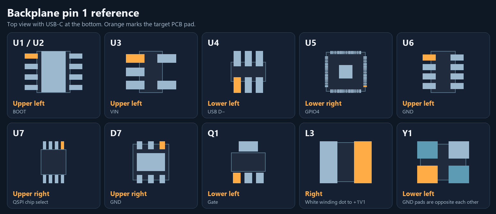

# Backplane placement check

Use this top view with the **USB-C port at the bottom**, the 24 V and 12 V terminal blocks on the left, and the debug connector on the right. The [backplane CPL](CPL.csv) uses the rotation conventions of the catalog parts listed here. Check any substitute against the same board pads after you select it. JLCPCB can use different zero angles for different packages. [JLCPCB placement guidance](https://jlcpcb.com/help/article/pcb-assembly-faqs-part-2)

## ICs and marked parts

| Designator | JLCPCB part | CPL rotation | Expected top-side orientation |
| --- | --- | ---: | --- |
| U1, U2 | TPS5450DDAR [`C114425`](https://jlcpcb.com/partdetail/C114425) | 270° | Pin 1 at **upper left** (BOOT). Four leads on each side. [TI datasheet](https://www.ti.com/lit/ds/symlink/tps5450.pdf) |
| U3 | AP2112K-3.3TRG1 [`C51118`](https://jlcpcb.com/partdetail/C51118) | 270° | Pin 1 at **upper left** (VIN). Three leads on the left, two on the right. [Diodes Inc. datasheet](https://www.diodes.com/assets/Datasheets/AP2112.pdf) |
| U4 | USBLC6-2SC6 [`C7519`](https://jlcpcb.com/partdetail/C7519) | 0° | Pin 1 at **lower left** (USB D−). Three leads along the top and bottom. [ST datasheet](https://www.st.com/resource/en/datasheet/usblc6-2.pdf) |
| U5 | RP2350B [`C42415655`](https://jlcpcb.com/partdetail/C42415655) | 180° | Pin 1 at **lower right** (GPIO4), on the right edge. The molded dot already matches in the preview. [RP2350B pinout](https://pip-assets.raspberrypi.com/categories/1214-rp2350/documents/RP-008374-DS-1-rp2350-product-brief.pdf) |
| U6 | TPS2116DRLR [`C3235557`](https://jlcpcb.com/partdetail/C3235557) | 270° | Pin 1 at **upper left** (GND). Four leads on each side. [TI datasheet](https://www.ti.com/lit/ds/symlink/tps2116.pdf) |
| U7 | W25Q128JVSIQ [`C97521`](https://jlcpcb.com/partdetail/C97521) | 180° | Pin 1 at **upper right** (QSPI chip select). Four leads along the top and bottom. [Winbond documentation](https://www.winbond.com/hq/support/documentation/?__locale=en&category=%2F.categories%2Fresources%2Fdatasheet%2F&family=%2Fproduct%2Fcode-storage-flash%2Fserial-nor-flash%2Findex.html&line=%2Fproduct%2Fcode-storage-flash%2Findex.html&pno=W25Q128JV) |
| Q1 | DMP6023LE-13 [`C154901`](https://jlcpcb.com/partdetail/C154901) | 270° | Gate at **lower left**, three small leads along the bottom and the wide drain tab at the top. [Diodes Inc. datasheet](https://www.diodes.com/datasheet/download/DMP6023LE.pdf) |
| D7 | TVS2700DRVR [`C523797`](https://jlcpcb.com/partdetail/C523797) | 180° | Pin 1 at **upper right**. All three pads along the top are GND. [TI datasheet](https://www.ti.com/lit/ds/symlink/tvs2700.pdf) |
| L3 | AOTA-B201610S3R3-101-T [`C42411119`](https://jlcpcb.com/partdetail/C42411119) | 0° | The physical white winding dot faces **right**, toward the `+1V1` pad and the board's silk dot. [Abracon drawing](https://abracon.com/datasheets/AOTA-B201610S3R3-101-T.pdf) · [RP2350B reference design](https://pip.raspberrypi.com/categories/1214-rp2350) |
| Y1 | ABM8-272-T3 [`C20625731`](https://jlcpcb.com/partdetail/C20625731) | 0° | Crystal electrodes at **lower left and upper right**. Case GND at upper left and lower right. Check this diagonal if Y1 was absent in the preview. The chamfer can be on different corners by lot. [Abracon drawing](https://abracon.com/datasheets/ABM8-272-T3.pdf) |

## Connectors, diodes and other parts

| Designator | JLCPCB part | Expected top-side orientation |
| --- | --- | --- |
| J1–J3 | WingTAT [`C5173363`](https://jlcpcb.com/partdetail/C5173363) | **180°**. A1 at the lower left of each socket, column 32 at the right. Row A is closest to the MCU. Check all three contact rows and both mounting holes. [WingTAT drawing](https://atta.szlcsc.com/upload/public/pdf/source/20220930/C0FC69953884A1BBCE49354FEE026DD0.pdf) |
| J4, J5 | Kefa [`C474952`](https://jlcpcb.com/partdetail/C474952) | Wire entry left. Upper terminal is +24 V or +12 V, respectively. Lower terminal is GND. |
| J6 | Kefa [`C474952`](https://jlcpcb.com/partdetail/C474952) | Wire entry down. Left terminal is +5 V, right terminal is GND. |
| J7 | HRO [`C165948`](https://jlcpcb.com/partdetail/C165948) | USB-C opening faces down. CPL center is `(115.600, -178.906)` mm. Align the twelve signal lands, two locating holes and four shell slots. |
| J9 | Megastar [`C7430445`](https://jlcpcb.com/partdetail/C7430445) | Mating opening faces right. Pin 1 is the lowest contact (SWCLK), then GND and SWDIO going up. |
| C5, C6, C12, C13 | KNSCHA [`C42371908`](https://jlcpcb.com/partdetail/C42371908) | Positive terminal at the top and negative stripe at the bottom. |
| D1, D3, D5, D6, D9, D10 | KT-0603R [`C2286`](https://jlcpcb.com/partdetail/C2286) | Cathode (KiCad pad 1) is down at D1, right at D3 and D6, and left at D5, D9 and D10. |
| D2, D4 | B540C-13-F [`C72264`](https://jlcpcb.com/partdetail/C72264) | Cathode band at the top. |
| D8 | BZT52C12 [`C43491`](https://jlcpcb.com/partdetail/C43491) | Cathode band at the right. |
| L1, L2 | Sumida [`C879410`](https://jlcpcb.com/partdetail/C879410) | **270°** puts the two bottom terminals over the upper and lower PCB lands. [Sumida land pattern](https://products.sumida.com/products/pdf/CDRH127LD_Ver2.0_E.pdf) |
| SW1, SW2 | B3U-1000P [`C271754`](https://jlcpcb.com/partdetail/C271754) | Contacts at the top and bottom. Either contact can serve as pin 1 electrically. |
| F1, all resistors and the remaining capacitors | See BOM | Nonpolar. Check that the two ends sit over their respective lands. |

The DIN96 CPL centers are 39.37 mm right and 2.54 mm up from the KiCad pad A1 origins. J7's center moved up by 1.394 mm to align its locating holes and shell slots with the catalog footprint. All 136 CPL designators match the backplane BOM. Recheck the live assembly preview after uploading and check the production DFM for the parts selected on the order. [JLCPCB CPL format](https://jlcpcb.com/help/article/pick-place-file-for-pcb-assembly)
