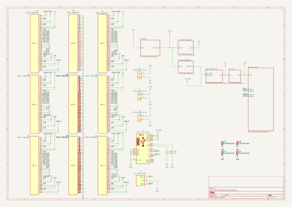

# Schematic previews

Seven SVG exports of the current KiCad source, generated on 2026-10-30 with KiCad 10.0.6. Open an image to zoom in, or use the editable [KiCad project](../../hardware/backplane/HackerfabBackplane.kicad_pro).

| Sheet | Preview |
| --- | --- |
| Root / backplane | [HackerfabBackplane.svg](HackerfabBackplane.svg) |
| 12 V buck regulator | [12 V supply](HackerfabBackplane-12V%20Buck%20Regulator.svg) |
| 5 V buck regulator | [5 V supply](HackerfabBackplane-5V%20Buck%20Regulator.svg) |
| 3.3 V LDO | [3.3 V supply](HackerfabBackplane-3V3%20LDO.svg) |
| Microcontroller | [RP2354B](HackerfabBackplane-Microcontroller.svg) |
| USB voltage mux | [USB power selection](HackerfabBackplane-USB%20Voltage%20MUX.svg) |
| Input protection | [Protection](HackerfabBackplane-Protection.svg) |

These are development schematics. See the [validation baseline](../validation.md) for unresolved findings. Regenerate previews from the repository root with `python scripts/export_design.py` after changing the source.
