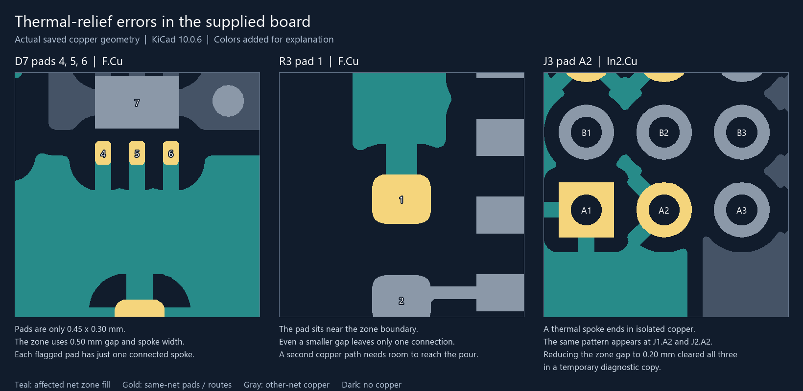

# Thermal-relief findings

**Historical investigation:** the 2026-11-02 source update now reports **zero thermal-relief findings**, zero DRC errors, and zero unconnected items. See the [current validation baseline](validation.md). The images, affected-pad list, and experiments below describe the earlier November 1 board and are not instructions to modify the current source.

Investigated with KiCad 10.0.6 on 2026-11-01 using the archives supplied that day. That imported source had **11 thermal-relief findings and zero unconnected items**. Refilling all zones reproduced the same findings. The mounting-hole ground-plane problem was resolved in those archives.

The image uses the board's saved zone polygons, pads, and routes, with colors added for explanation. Teal is the affected net's zone copper; gold is its pads and routes; gray is other-net copper. It is an inspection illustration, not a fabrication plot.

## Why the pours look unusual

The seven affected zones all specify a **0.50 mm thermal gap**, **0.50 mm spoke width**, and **0.25 mm minimum zone width**. The affected pads inherit the gap and spoke width. Their geometry does not always leave room for the required two connected spokes.

Eight surface-pad findings report one connected spoke where two are required. Three connector findings report a spoke ending in an isolated copper patch on the +24V_P inner plane. A pad can still have an electrical connection through another path while failing this thermal-relief check.

KiCad's gap setting controls the separation between a pad and its same-net pour. Its DRC also counts manually routed copper connections when checking the number of spokes. See the [KiCad zone settings](https://docs.kicad.org/10.0/en/pcbnew/pcbnew.html) and [DRC documentation](https://docs.kicad.org/10.0/en/pcbnew/pcbnew.html).

## Affected pads

| Pads | Layer / net | Finding | Diagnostic result |
| --- | --- | --- | --- |
| U2 pad 5 | F.Cu / +24V_P | One connected spoke | Clears with 0.20 mm zone thermal gap |
| U3 pad 1 | F.Cu / +5V | One connected spoke | Clears with 0.20 mm zone thermal gap |
| J1, J2, J3 pad A2 | In2.Cu / +24V_P | Spoke reaches isolated copper | All three clear with 0.20 mm zone thermal gap |
| U1 pad 5 | F.Cu / +24V_P | One connected spoke | Remains after smaller gap and spoke-width experiments |
| Q1 pad 2 | F.Cu / Net-(F1-Pad1) | One connected spoke | Remains after smaller gap and spoke-width experiments |
| R3 pad 1 | F.Cu / Net-(C5-Pad1) | One connected spoke near zone edge | Remains after smaller gap and spoke-width experiments |
| D7 pads 4, 5, 6 | F.Cu / +24V_P | One connected spoke per pad | Remains after smaller gap and spoke-width experiments |

D7's flagged pads are only **0.45 x 0.30 mm**, compared with the zone's 0.50 mm gap and nominal spoke width. Its pour reaches the pads from one side; nearby different-net copper constrains the other directions. R3's image likewise shows a single copper neck reaching a pad near the zone boundary. Making the spokes narrower alone does not provide a second path.

## Tested adjustment for five findings

The following was tested on a temporary copy. These adjustments are **not applied to the imported source**.

1. In the PCB Editor, run **Inspect → Design Rules Checker** and select the relevant thermal-relief finding to locate its pad and zone.
2. Edit the zone boundary with **E**. Change **Thermal relief gap** from **0.50 mm to 0.20 mm** in these three zones only:

   | Zone | Layer | Priority in this source | Boundary starts at (mm) |
   | --- | --- | ---: | --- |
   | +24V_P beside U2 pad 5 | F.Cu | 35 | 58.4, 165.7 |
   | +5V beside U3 pad 1 | F.Cu | 45 | 84.0, 159.0 |
   | +24V_P inner plane | In2.Cu | 0 | 40.2, 18.8 |

3. Keep the **0.50 mm spoke width**, copper clearance, and minimum spoke count unchanged. The thermal gap and different-net clearance are separate settings.
4. Press **B** and rerun DRC.

This exact three-zone experiment reduced thermal findings **11 → 6** and total DRC findings **368 → 363**, retaining **zero unconnected items and zero schematic/PCB parity findings**. It establishes a geometry fix to review for the intended assembly and current requirements, not manufacturing qualification.

## The remaining six findings

For **U1.5, Q1.2, R3.1, and D7.4–6**, inspect the pad and same-net copper together. Move or extend the zone edge where space permits, or route an additional short same-net connection from the pad to the main pour while preserving clearance. Refill and check that the added connection actually reaches the main copper area. If a solid connection is appropriate for the pad's assembly and electrical requirements, a local **Pad Properties → Connections → Solid** override is another option; that option was not validated in these experiments.

Changing the affected zones to a 0.20 mm gap and a 0.25 mm spoke width still left the same six findings. Lowering the required spoke count would change the acceptance criterion without adding copper, so it is not the proposed geometry correction.

## Experiment record

| Temporary-copy experiment | Thermal findings | Total DRC findings | Unconnected items |
| --- | ---: | ---: | ---: |
| Refill supplied board only | 11 | 368 | 0 |
| Seven affected zones: gap 0.20 mm, spoke 0.50 mm | 6 | 363 | 0 |
| Seven affected zones: gap 0.20 mm, spoke 0.25 mm | 6 | 363 | 0 |
| Only the three zones listed above: gap 0.20 mm, spoke 0.50 mm | 6 | 363 | 0 |

Reports were generated with `kicad-cli pcb drc --refill-zones --format json`. The focused three-zone experiment also passed schematic/PCB parity. The repository retains the archive's board and library contents after line-ending normalization; the [validation baseline](validation.md) describes that imported source.
