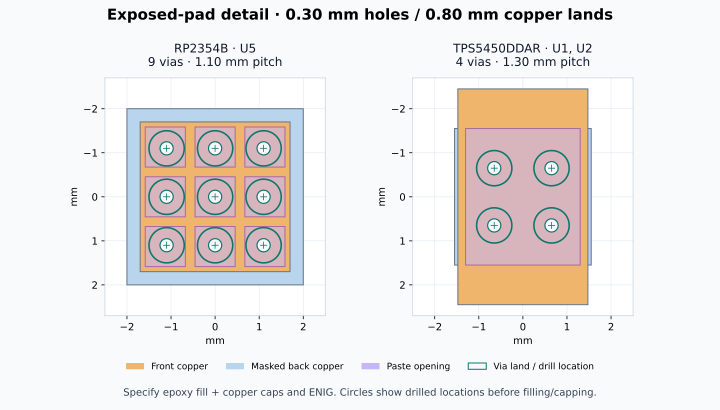

# Embedded ground and thermal vias

The RP2354B (U5) and TPS5450DDAR (U1, U2) footprints now include plated through-hole thermal pads. The libraries and all three PCB instances use the same geometry. Existing footprint identifiers, signal pads, component placement, and schematic connections are preserved.

**Assembly process: epoxy-filled and copper-capped vias, with ENIG finish.** This is a fabrication requirement for these footprints, not an optional interpretation of the solder-mask layers. The exposed front pads and their original solder-paste apertures remain in place over the finished copper caps. Do not order these as ordinary open or merely tented vias.

## Geometry

All dimensions below are in millimetres. Coordinates are local to the footprint origin.

| Parameter | RP2354B | TPS5450DDAR |
| --- | --- | --- |
| Exposed ground pad number | 81 | 9 |
| Via array | 3 × 3, nine holes | 2 × 2, four holes |
| Hole centres | X and Y: −1.10, 0, +1.10 | X and Y: −0.65, +0.65 |
| Hole / copper land diameter | 0.30 / 0.80 | 0.30 / 0.80 |
| Radial annular ring | 0.25 | 0.25 |
| Nearest hole-edge spacing | 0.80 | 1.00 |
| Back copper spreader | 4.00 × 4.00 | 3.10 × 3.10 |

The holes share the exposed pad number and therefore its GND net. All thermal pads use solid zone connections. The back copper has no solder-mask opening and extends at least 0.50 mm beyond the via lands. These local spreaders must be connected to the board's ground copper during routing; they do not replace a ground plane or a thermal assessment.

The TPS5450 array follows the four-hole, 1.30 mm pitch arrangement in TI's DDA0008J board-layout example, with the hole diameter increased from its 0.20 mm example to 0.30 mm. The RP2354B uses a 1.10 mm pitch grid inside the existing 3.40 mm square exposed pad.

## JLCPCB fabrication instructions

Target: the current 1.6 mm FR-4 board, 1 oz outer copper, ENIG. Select **Epoxy Filled & Capped** and include this note with the eventual manufacturing files:

> Fill and copper-cap all 17 thermal holes, diameter 0.30 mm, under U5 (nine), U1 (four), and U2 (four). These are vias in the exposed GND pads, not component lead holes. Planar copper caps are required on the component side. Retain the supplied solder-mask and paste geometry. Use ENIG. See the thermal-via drawing for identification.

KiCad represents holes embedded in a footprint as numbered plated pads, so explicitly identify these holes to the fabricator; do not rely on a generic via-covering setting alone. The hidden `ThermalViaProcess` property in each footprint also records the requirement. The board's global via defaults apply to separately placed routing vias and are not a fabrication instruction for these footprint pads.

JLCPCB's published capabilities were checked on 2026-10-28. The new geometry exceeds its published via limits and also meets the more conservative 1 oz, two-layer PTH recommendation of a 0.25 mm annular ring and 0.45 mm hole-edge spacing. The specified 0.30 mm holes are within its filled-via size range. Filling and capping are additional order options; the geometry alone does not request them. Confirm the process and production files with JLCPCB when ordering.

## Validation and scope

Geometry checks verify all 17 holes, GND assignment, pad numbers, annular rings, hole separation, containment, back-copper margins, and agreement between libraries and PCB instances. Original signal-pad and paste geometry are unchanged. See [validation notes](validation.md) for KiCad results.

This change adds the thermal connections inside the footprints. The backplane remains unrouted and is not a manufacturing release. It does not resolve the existing ERC/DRC findings or the previously identified TPS5450 ENA connection to the 24 V rail.

## References

- [JLCPCB PCB capabilities](https://jlcpcb.com/capabilities/pcb-capabilities): drilling, PTH annular rings, hole spacing, and filled/capped vias.
- [JLCPCB via covering](https://jlcpcb.com/help/article/pcb-via-covering): filled/capped processing and explicit identification of holes.
- [TI TPS5450 datasheet](https://www.ti.com/lit/ds/symlink/tps5450.pdf): section 10 and DDA0008J package/board-layout drawings.
- [Raspberry Pi RP2350-family datasheet](https://datasheets.raspberrypi.com/rp2350/rp2350-datasheet.pdf): QFN-80 package and ground connection.
- [KiCad thermal-pad conventions](https://klc.kicad.org/footprint/f4/f4.4/): common pad numbering and masked back copper. Paste over these holes relies on filled copper caps; it is not suitable for unfilled 0.30 mm holes. Project footprint identifiers are retained rather than adding separate `_ThermalVias` variants.
